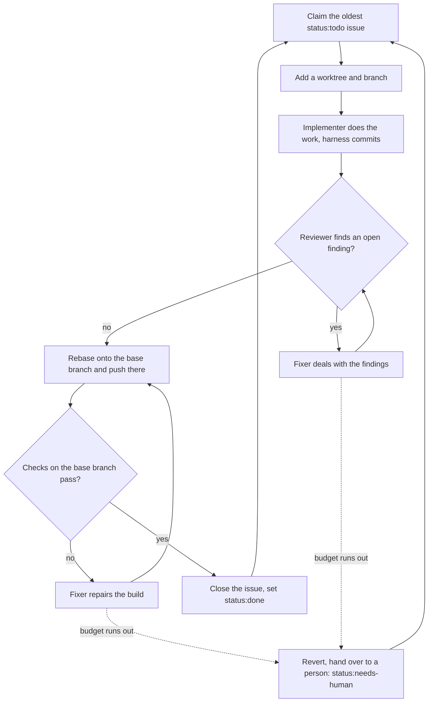

# next-issue

A small harness that works through the open issues of a GitHub repository with
the [pi](https://github.com/earendil-works/pi) SDK. Run it inside a git repository.

```bash
npx -y next-issue@latest
```

## Overview

The harness claims the oldest open issue with the `status:todo` label and gives it its own git worktree and branch. An implementer agent does the work and the harness commits it. A reviewer agent judges the diff, and a fixer agent deals with any open finding, and the review runs again. With no open finding left, the harness rebases the change onto the base branch as one commit, pushes it there with no pull request and waits for the checks of that commit. On a red build the harness reruns the failed jobs once, and only a second red build goes to the fixer, whose fix lands the same way. When the checks pass, the issue is closed and gets `status:done`. When a budget runs out or the work cannot go on, the issue gets `status:needs-human` and goes to a person. Then the harness takes the next issue.



## What it does

Before each issue, fetch the open issues again and take the oldest one not yet
seen in this run. An issue seen once in a run, also a skipped or failed one, is
not tried again in that run. The run ends when no unseen issue is left. When
the fetch fails, the run claims no new issue, ends once the running issues end,
writes the summary of the issues it handled and exits with code 1.

A run handles up to `concurrency` issues at the same time, 1 by default. When an
issue ends, the run fetches the open issues again and claims the oldest unseen
one for the free slot. Each issue has its own worktree and branch. Step 3 below
and the removal of a worktree or branch run for one issue at a time, so two
issues never change the git refs or worktrees of the repository at once. An issue blocked by a running issue is skipped and not tried again in
that run, even when the blocker closes before the run ends. `--max <n>` counts the handled issues across the run, and with `--once`
the run handles one issue. For each issue:

1. Claim the issue only when it holds the `status:todo` label and holds no
   `status:in-progress` or `status:in-review` label. A `status:done`,
   `status:needs-human` or `status:blocked` label always stops the claim, a
   resume too, except a `status:needs-human` issue with an answer to its
   hand-over. An issue that GitHub lists as blocked by an open issue waits,
   because its blocker closes only when the change of the blocker lands.
   An issue with saved state under `.next-issue/` resumes instead, whatever its
   other labels and blockers.
2. Add `status:in-progress` to the issue.
3. Fetch the remote, fast-forward the local copy of the default branch when
   that is safe, then add a git worktree at `.worktrees/<n>` in the
   repository root on the `<n>` branch. An issue that resumes from saved
   state keeps the branch name that the state holds, and a worktree that
   holds that branch already stays in use. A branch that exists on the
   remote is the start, and a local branch that fell behind the remote is
   fast-forwarded. A local branch that the remote does not hold and that has
   no commits of its own starts again from the remote base. An issue with no
   saved state does not reuse a local `<n>` branch: it resets that branch,
   and any worktree that holds it, to the remote branch, or to the remote
   base when there is none. A fast-forward of the base that is not safe
   leaves the local base branch as it is and writes a `base.behind` event. A
   new branch then starts from the remote base.
4. Let the implementer agent do the work, then commit it. For a behaviour
   change, the implementer writes the test first and quotes its failing output
   in its reply. The harness keeps that reply in the state file for the
   reviewer. The branch is not pushed. When a git
   hook stops a commit, the agent that made the change gets the hook output,
   fixes it, and the harness commits again. A `commit:` line in the reply of
   the agent replaces the subject, so a hook that rejects the subject can pass.
   The budget is `maxCommitFixes`. Any other git failure in the commit stops
   the run with an error. An implementer that makes no change hands the issue
   to a person, unless the branch is already ahead of the base, for example
   after the state file was lost: the run then carries on with the commits on
   the branch, and the newest of them gives the subject of the landed commit.
5. Let the reviewer agent judge the diff, at most `diffMaxChars` of it. The
   reviewer reads files and runs commands in the worktree, so it can prove a
   finding with the tests or the type check. The harness then throws away every
   change that the reviewer left, so no such change can reach a later commit.
   The first reviewer also gets the reply of the implementer, and raises a
   finding when a behaviour change has no failing run of its test. A later
   reviewer gets the reply of the last review fixer instead, who quotes the
   failing run of a test for a behaviour change.
   The reviewer ends its last message with its verdict as a json block: a
   summary and one entry per finding, each rated `blocking` or `minor`. A
   reply without a valid block hands the issue to a person. The findings are the only ground
   truth. The reviewer gives no approve or reject field, because such a field
   can contradict the findings. The harness puts the result on the issue.
6. An open finding is any finding, blocking or minor, while a review round is
   left. In the last round, only a blocking finding stays open: a minor finding
   there goes on the issue but starts no fix, because a fix in the last
   round gets no review. Thus `maxReviewRounds` of `1` never fixes a minor
   finding.
7. No open finding means approval: the change lands on the base branch.
   Approved changes land one at a time, so the next one waits until the
   checks of the last one end, and other issues go on meanwhile. The
   harness fetches the remote base, merges it into the branch and makes the
   change one commit on top of it, with the subject of the newest commit of
   the change. When git merges the base cleanly, no agent runs. When git
   reports conflicted files, the fixer gets the list from the check budget,
   `maxCiFixes`, removes the conflict markers, and the harness commits the
   merge. With the budget used up, or when the fixer leaves a conflict marker
   or the merge unresolved, or the fixer fails, the harness undoes the merge
   and hands the issue to a person with the reason `merge conflict`. The
   harness then pushes the commit to the base branch, without force. A push
   that the remote refuses, for example because the base moved, starts the
   rebase again, three times at most. The harness then waits for the checks
   of the pushed commit on the base branch. A repository that reports no
   check keeps asking for `checkGraceSeconds`. A pending state waits again,
   up to `checkTimeoutMinutes`. A read that fails is tried three times. When
   the checks pass, the harness closes the issue and sets `status:done`,
   fetches the remote and fast-forwards the local base branch to the landed
   commit when that is safe, and the worktree, the local branch and the state
   file go away. A fetch that fails or a fast-forward that is not safe leaves
   the local base branch as it is and writes a `base.behind` event, and the
   issue is still done. When the checks fail, the harness reruns the failed
   jobs once with `gh run rerun <id> --failed`, records a
   `main-checks.rerun` event, saves the rerun in the state file and waits
   again once the runs restart. When the rerun cannot start, or the checks
   fail again, the fixer gets their logs from the check budget, and its fix lands
   the same way. When the fixer cannot fix them, its fix cannot land, or the
   budget runs out, the harness reverts every commit of the change on the
   base branch, pushes the revert and hands the issue to a person. A revert
   push that the remote refuses, for example because the base moved, makes
   the revert again on the new base, three times at most. A resume
   that stopped while the checks of a landed commit ran waits for them
   again, even when more commits landed on the base since, and a fix that
   was committed but not landed lands first. A problem that the reviewer
   leaves out of the findings thus gets an approval: only the findings count.
8. With an open finding, run the fixer agent and go to step 5 again. The
   budget is `maxReviewRounds`. A fixer that holds every finding to be wrong
   changes nothing and gives its reason instead. The reason goes on the issue
   and into the next round, where it answers every finding of its own
   round, so the reviewer withdraws them all or repeats them all. With only
   some findings wrong, the fixer fixes the correct ones, and the next round
   holds the rest. A fixer that settles every finding with no code change,
   for example by showing a failing test run, changes nothing and ends with a
   `resolved:` line instead. The note goes on the issue and into the next
   round in the same way, and a change it leaves behind is handled as for a
   dispute.

## Issue format

Every agent prompt holds the body of the issue and the comments of users with write or admin access to the repository. An issue reads best with these sections, in this order:

1. `Problem`
2. `Context and findings`
3. `Acceptance criteria`
4. `Out of scope`
5. `Open questions`, empty when the issue is created

The list lives in `src/issue-format.mts`. The `create-issue` skill of [`@ravshansbox/pi-next-issue`](../pi-next-issue) writes an issue in this format, and a contract test fails when its template and the list disagree. The harness does not reject an issue without the format.

## Stops for a loop

The harness hands the issue to a person, with the `status:needs-human` label,
and comments the reason on the issue, when:

- the check budget or the review budget runs out. A finding that the reviewer
  repeats, even one that the fixer disputed or settled, goes back to the fixer
  until the review budget runs out;
- a fixer round adds no commit and gives no reason, so there is no progress;
- the fixer reports that the checks fail for a reason the change did not cause,
  such as a test already broken on the base branch or one that fails only under
  load. It changes nothing and the reason reaches the issue, rather than
  the fixer spending its whole budget on a failure it cannot fix. A commit it
  makes anyway moves aside, as for a dispute of the findings;
- a fixer disputes or settles the findings and leaves a change behind, either
  in the worktree or in a commit of its own. A dispute carries a reason, not a
  diff, so the harness throws none of it away: an unclean worktree stays on
  the disk, and a commit of the fixer moves to a new local
  `<n>-dispute-<commit>` branch, so the `<n>` branch keeps only what will
  land. The worktree drops the change of that commit, unless the fixer edited
  the worktree after the commit: then the worktree keeps both and stays on the
  disk. Neither lands. The issue holds the reason of the dispute, and the
  change is on the machine that ran the harness. The `<n>-dispute-<commit>`
  branches go away with the `<n>` branch when the issue is done;
- the reviewer gives no verdict, or the checks do not finish in time;
- the push to the base branch fails three times;
- the checks on the base branch fail and the fixer cannot fix them, or they
  do not finish in time. The base branch is then broken, so the run claims
  no new issue and ends once the running issues end;
- an agent does not finish in `agentTimeoutMinutes`;
- the setup command fails, or does not finish in `setupTimeoutMinutes`;
- a step of the run fails with an error. A `gh` call that is safe to repeat,
  such as a read or a label edit, is tried up to three times first when the
  network fails. A `gh issue comment` is
  tried once, so a lost reply never makes a duplicate.

The fixer sees the findings of all earlier rounds, not only the last one, with
its own disputes next to them. From round two, the reviewer judges only the
earlier findings and any regression.

Each agent that writes to the issue names itself in the first line of the
comment: `### Review: approved`, `### Review: changes requested`,
`### Fixer: no change` and `### Fixer: settled with no change`. The account is
the same for all of them, so the heading, not the author, tells them apart.
The agents get no comment that starts with one of these headings or with
`next-issue needs help:`, so a comment of an agent never returns to a
prompt: the dispute of the fixer reaches the reviewer through the state file.
The one exception is the answer to a hand-over, see
[Retry an issue that waits for a person](#retry-an-issue-that-waits-for-a-person).

## Stop a run

Press `Ctrl-C` to stop the run step by step:

1. The first press stops new claims. The harness finishes every issue that it
   holds and then writes the summary as usual.
2. The second press stops every running issue after its current round: the
   implementation or one review round (review, then fix). An issue that
   lands goes on until its checks on the base branch end. The issue ends as `stopped`. Its state, worktree and
   labels stay, so the next run carries on from that point.
3. The third press stops every agent, kills the command that runs and every
   child of it, so the run dies in the middle of a step. The saved state lets the next run continue the
   issue, but the issue keeps `status:in-progress` and the run writes no
   summary.

Signals that arrive within 100 ms of the last counted one count as one press,
because `npx` and `npm exec` pass on a press as a second signal.

Each of the first two presses prints a line that says what happens next. The
agents run inside the harness, and their commands and the harness commands run
in a process group of their own, so a press reaches only the harness.

The harness runs all git and `gh` commands itself. The commit holds all the
changes in the worktree, so a setup command that writes a file that git does
not ignore puts that file in the commit. The reviewer is the one agent whose
changes never get that far: the harness discards them, and undoes any commit
that the reviewer made, before it reads the verdict.

## Safety

Every agent can run a shell command. The implementer and the fixer run with the
permission checks off; the reviewer runs with a smaller tool set, but its shell
has no limit on the commands. They all start in the worktree, but nothing holds
them there: they can run any command, with your rights, anywhere on the machine.
The prompt holds the title and the body of the issue, which come from GitHub.
It also holds the comments of the issue, but only those by users with write or
admin access to the repository. The harness leaves out every other comment and
writes a `comment.skip` event with its author to the run log. If an access check
fails for a reason other than a 404, the issue stops with an error.

Thus a person who can write an issue, or a writer who can comment, can try to
give an instruction to the agent. Use the harness only on a repository where you
trust the issue authors, or run it in a container.

[ADR 0001](https://github.com/ravshansbox/next-issue/blob/main/docs/adr/0001-reviewer-isolation.md) records why the reviewer
keeps a full shell, and which other options were considered.

## Observability

Every run has an id, `<timestamp>`, and writes these under `.next-issue/runs/`:

- `<id>.jsonl` — one JSON object per event, with `ts`, `runId`, `kind`, and the
  `issue`, `role` or `round` in scope;
- `<id>.summary.json` — token totals per agent role, event counts, and
  one report per issue with the outcome, the reason and the budgets used;
- `<id>/sessions/` — the full pi session of each agent call, with every
  message, tool call and tool result. The session id in a `usage` event is
  part of the file name.

At the start of a run, the harness deletes the files and folders under
`.next-issue/runs/` that are older than `keepRunDays`. Set the field to `0` to keep them all.

A short text summary of the same data goes to standard output. Use `--json` to
get the full summary object there instead, so the harness fits in a pipe. All
progress goes to standard error.

Recorded for each step: `claim`, `comments`, `reply`, `worktree`, `setup`,
`implement`, `review`, `fix`, `commit-fix`, `rebase`, `land`, `main-checks`, `revert` and `hunt`, each with a
`.start`, `.end` or `.error` event and a duration in `ms`. Every `git` and `gh`
command is recorded with its exit code and duration. A `tool` event holds the
tool name, and for a `bash` tool the command too. Each agent call adds a `usage`
event with the tokens, the cost estimate in dollars, the turn count, the
tool-call count, the model and the session id.

```bash
jq -r 'select(.kind=="usage") | [.issue,.role,.turns,.total] | @tsv' \
  .next-issue/runs/*.jsonl
```

`next-issue logs` shows the newest run log, one readable line per event, and
then prints new events as the run adds them, until `Ctrl-C`. In a terminal it
starts with the last events that fit the screen; in a pipe it starts with all
of them. It stops when the reader of the pipe closes it; on Linux it notices
this only at the next event. When the worker restarts and starts a new run log, `logs` prints the rest of the old one, then a line `— new run: <file name> —`, then every event of the new one. With `--json` it prints the raw JSON lines and no such line. This also shows a run of
the worker, whose progress goes to no terminal.

Three levels of console output:

| Level       | Shows                                                            |
| ----------- | ---------------------------------------------------------------- |
| `--quiet`   | Run and issue milestones, verdicts, hand-overs, errors           |
| default     | The above plus each step end, each tool call and failed commands |
| `--verbose` | The above plus every command and all agent text                  |

## Requirements

- Node 24 or later
- `gh`, authenticated with write access to the repository
- pi, logged in to a model provider. The agents use the model, the thinking
  level, the extensions and the skills from your pi settings, except the
  extension and the skills of `pi-next-issue`. The implementer and the fixer
  get the default tools of your pi settings, the `grep`, `find` and `ls` tools
  and the tools of your extensions. The reviewer gets all of them except
  `edit` and `write`. The agents run with `GIT_OPTIONAL_LOCKS=0`, so a
  `git status` from an agent or an extension does not hold the index lock
  while the harness commits.

## Configuration

To write the file with the defaults, run the `init` command in the repository:

```bash
npx -y next-issue@latest init
```

The command writes `.next-issue/config.json` in the repository and adds
`.next-issue/` and `.worktrees/` to `info/exclude` in the git directory, which
linked worktrees share. It removes those two lines from `.gitignore`, and
deletes `.gitignore` when nothing else is left in it. It moves a
`next-issue.config.json` in the root to `.next-issue/config.json`; every other
command stops while that old file is there. It stops when the config file is
there already; `--force` replaces it. The file holds no
`setupCommand`, because the harness deduces one from the lock file of the
project.

With no file, every field keeps its default. A field that is not in the file
keeps its default. A file that cannot be read, a file that is not valid
JSON, a field with a value of the wrong type and a field name that the harness
does not know all stop the run, so a typo cannot pass without a word. An old
`draftPullRequest` field stops the run with an error that says to remove it,
because no pull request is opened.

```json
{
  "remote": "origin",
  "issueLimit": 100,
  "concurrency": 1,
  "huntCap": 1,
  "maxCiFixes": 5,
  "maxCommitFixes": 10,
  "maxReviewRounds": 5,
  "checkIntervalSeconds": 15,
  "checkGraceSeconds": 60,
  "checkTimeoutMinutes": 60,
  "agentTimeoutMinutes": 30,
  "setupTimeoutMinutes": 15,
  "commandTimeoutMinutes": 10,
  "logMaxChars": 20000,
  "diffMaxChars": 60000,
  "keepRunDays": 7,
  "models": {
    "implementer": null,
    "reviewer": null,
    "fixer": null
  },
  "labels": {
    "ready": "status:todo",
    "inProgress": "status:in-progress",
    "inReview": "status:in-review",
    "done": "status:done",
    "needsHuman": "status:needs-human",
    "skip": "status:blocked",
    "hunt": "source:hunt"
  }
}
```

| Field                   | Default            | Effect                                                                                                                               |
| ----------------------- | ------------------ | ------------------------------------------------------------------------------------------------------------------------------------ |
| `remote`                | `origin`           | The git remote for the repository and the branches                                                                                   |
| `issueLimit`            | `100`              | The maximum number of open issues to read. With `labels.ready` set, only issues with the ready, in-progress or in-review label count |
| `concurrency`           | `1`                | The most issues that a run handles at the same time                                                                                  |
| `huntCap`               | `1`                | With `--hunt`, the hunter hunts only while fewer ready issues than this wait besides the running ones                                |
| `maxCiFixes`            | `5`                | The budget for check fixes per issue                                                                                                 |
| `maxCommitFixes`        | `10`               | The budget for fixes of a commit that a git hook stopped, per issue                                                                  |
| `maxReviewRounds`       | `5`                | The budget for review rounds per issue                                                                                               |
| `checkIntervalSeconds`  | `15`               | The time between two check states                                                                                                    |
| `checkGraceSeconds`     | `60`               | The time to wait for the first check to show                                                                                         |
| `checkTimeoutMinutes`   | `60`               | The limit for one check wait                                                                                                         |
| `agentTimeoutMinutes`   | `30`               | The limit for one agent call                                                                                                         |
| `setupTimeoutMinutes`   | `15`               | The limit for the setup command                                                                                                      |
| `commandTimeoutMinutes` | `10`               | The limit for one `git` or `gh` command                                                                                              |
| `logMaxChars`           | `20000`            | The maximum length of the failed job logs, shared between the failed jobs                                                            |
| `diffMaxChars`          | `60000`            | The maximum length of the diff that the reviewer reads                                                                               |
| `keepRunDays`           | `7`                | The number of days to keep the run files; `0` keeps them all                                                                         |
| `setupCommand`          | from the lock file | A shell command to run in a new worktree, before the implementer                                                                     |
| `models`                | `null` per role    | The pi model per agent role, as `provider/model`: `implementer`, `reviewer`, `fixer`                                                 |
| `labels`                | see above          | The names of the labels that the harness reads and sets                                                                              |

The hunter adds `labels.hunt` to each issue it files, so you can tell those
issues apart from your own and filter them.

An empty `labels.ready` turns the ready requirement off. The harness then
claims every open issue that no other label holds back.

The log gives the reason for a skipped issue as `stop-label`, `not-ready`,
`in-flight` or `blocked`, the last one with the open blockers.

A role set to `null`, or with no entry in `models`, uses the default model of
your pi settings.

Without a `setupCommand`, the harness looks in the new worktree for a lock file
and runs the install command that goes with it:

| Lock file               | Command                                                                              |
| ----------------------- | ------------------------------------------------------------------------------------ |
| `pnpm-lock.yaml`        | `pnpm install --frozen-lockfile`                                                     |
| `package-lock.json`     | `npm ci`                                                                             |
| `yarn.lock`             | `yarn install --frozen-lockfile`, or `yarn install --immutable` with a `.yarnrc.yml` |
| `bun.lock`, `bun.lockb` | `bun install --frozen-lockfile`                                                      |
| `Cargo.lock`            | `cargo fetch`                                                                        |
| `go.sum`                | `go mod download`                                                                    |
| `uv.lock`               | `uv sync`                                                                            |
| `poetry.lock`           | `poetry install`                                                                     |
| `Gemfile.lock`          | `bundle install`                                                                     |

The first match in that order wins. A project with no lock file in the list
runs no setup, and a `setupCommand` in the config file always wins. Thus the
agents find a worktree with its dependencies in place, and the reviewer can run
the tests. Each command holds to the lock file, so a lock file that does not
match the manifest stops the issue rather than changing the lock file.

A `setupCommand` that fails, or that does not finish in `setupTimeoutMinutes`,
hands the issue to a person. The wait for the checks has its own limit, so
`commandTimeoutMinutes` holds for every other `git` and `gh` command. State per
issue goes to `.next-issue/<issue>.json`, so a new run continues where the last
run stopped. A state file that is not valid JSON, or that does not hold a valid
state, gives the issue an `error` outcome that names the file, rather than a
silent skip.

Every agent prompt holds `.next-issue/notes.md` when it exists, so lessons
such as test commands, tool quirks and deliberate behaviour carry over from one
issue to the next. The implementer and the fixer may add a short note to it, and
the prompt asks them to keep only what still holds. The reviewer only reads it.

## Retry an issue that waits for a person

When the implementer makes no change, the hand-over comment holds its full
reply after the note, so its reasons and questions can be answered on the issue.
A reply too long for a GitHub comment is cut to fit, with a line that says so.

A hand-over marks the state file as handed over. To give the issue another try,
take the `status:needs-human` label off, or answer the hand-over. The next run
that claims the issue puts the budgets and the findings back to zero, clears
the mark and keeps the branch and the step that the last run reached, so the
work carries on where it stopped. After a revert, the branch holds the change
again on top of the revert, so the change goes back to the review. An issue
that still has the label is not claimed, unless it has an answer to the
hand-over: then the run claims it and takes the label off.

To give guidance, answer the hand-over with a comment on the issue. When the run
resumes the issue, it reads the comments posted after its last
`next-issue needs help:` comment there. Only comments from users with write
access to the repository count, for the hand-over comment too. A comment that
starts with one of the headings of the harness never counts as an answer. The
implementer and every fixer of that run get them in their prompt, under the
heading `Answer of a person to the hand-over`. A short reply such as "ready,
take it" is enough. With no such comment, the run resumes with no guidance.

The `--reset` flag does the same for any issue that the run handles, whether or
not it was handed over. It touches only an issue that the run handles, so the
state of an issue that a label still holds back stays as it was.

## Commands and options

| Argument    | Effect                                                                                 |
| ----------- | -------------------------------------------------------------------------------------- |
| `init`      | Write the config file with the defaults                                                |
| `serve`     | Run the worker of this repository that pi extensions talk to, see [Worker](#worker)    |
| `stop`      | Stop the worker of this repository, see [Worker](#worker)                              |
| `logs`      | Show the latest run log and follow it, see [Observability](#observability)             |
| `--force`   | Replace an existing config file, with `init`                                           |
| `--once`    | Stop after the first handled issue                                                     |
| `--max <n>` | Handle at most n issues                                                                |
| `--watch`   | Keep running, and read the open issues again after each pass                           |
| `--hunt`    | Hunt the repository for bugs alongside the issues, see [Hunt for bugs](#hunt-for-bugs) |
| `--reset`   | Drop the saved budgets and findings, and keep the rest of the state                    |
| `--json`    | Print the machine summary instead of the text one, or the raw JSON lines with `logs`   |
| `--verbose` | Show every command and all agent output                                                |
| `--quiet`   | Show only the milestones and the summary                                               |
| `--help`    | Show the option list                                                                   |

The exit code is 1 when an issue needs a person or failed, and 0 when it does
not, so a cron job or a CI step can read the result of the run.

## Watch for new issues

A run without `--watch` ends when no unseen issue is left. With `--watch`, the
harness then waits, reads the open issues again and runs another pass, so it
picks up an issue that someone opens during the run, or one whose blocker
closes. Each pass tries every open issue again, also one that an earlier pass
skipped. An issue that failed in an earlier pass is not tried again until the
next run.

The waits follow a fixed back-off in minutes: 1, 2, 3, 5, 10, then 10 from then
on. A pass that handles an issue, with any outcome other than `skipped`, resets
the back-off to 1 minute. A pass where every issue is skipped does not reset
it. Each wait prints a line on standard error with the minutes until the next
pass.

After each pass that handled an issue, the harness prints the summary of that
pass. The token totals in it cover that pass only. The exit code at the end
covers all passes. `--max <n>` counts the handled issues across all passes,
and `--once` is the same as `--max 1`.

The watch stops:

- at the first `Ctrl-C` during a wait, at once;
- at the first `Ctrl-C` during an issue, after the running issues;
- after a pass that halts the run, for example when the checks on the base
  branch failed;
- when the open issues cannot be read.

## Hunt for bugs

With `--hunt`, which turns on `--watch`, the harness runs a hunter agent at the same time as the issues. Before each hunt it reads the open issues with the `labels.ready` label and counts those that are ready to claim, have no open blocker and are not running. It hunts only while that count is less than `huntCap`, 1 by default. Otherwise it waits and checks again, with the same back-off as the watch: 1, 2, 3, 5, 10, then 10 minutes, back to 1 minute after a hunt that files an issue. Each wait writes a `hunt.wait` event with the `minutes` to the run log. A hunt that files nothing backs off like a failed one. When the harness claims an issue, the hunter wakes: it ends its wait at once, or skips the wait after a hunt that is going, and checks the count again. A wake keeps the back-off where it was. The hunter:

- works in its own worktree at `.worktrees/hunt`, at the remote base branch, which the harness fetches and resets before each hunt;
- follows `next-issue.hunt.md` in the repository root, or a short built-in prompt when the file is missing;
- files up to `huntCap` less that count, worked out just before the hunt, its most serious findings first, each with the `labels.ready` label, the `labels.hunt` label and the sections of the [issue format](#issue-format), after a search for duplicates. The `labels.hunt` label, `source:hunt` by default, marks the issue as one the hunter filed, and the harness creates it before the hunt when it is missing. It files nothing when it finds no real problem or a duplicate exists;
- runs no test suite and changes no file. It gets the tools of the reviewer.

With `huntCap` at 1 and no ready issue, a hunt files at most one issue. The hunter ends its reply with one `issue:` line for each issue it filed, or one `issue: none` line, and the run log holds one `hunt.issue` event with the `url` for each, or one with `none`. A hunt that fails writes a `hunt.error` event and the watch goes on. The hunter then waits before the next hunt, with a `hunt.wait` event and the same back-off, so a failure, or a hunt that files nothing, that repeats waits 1, 2, 3, 5, 10, then 10 minutes, and the back-off goes back to 1 minute after a hunt that files at least one issue. The next pass claims the new issues like any other. At the first `Ctrl-C` the hunter stops after its current hunt, and the watch ends once the hunt and the running issues end. A first `Ctrl-C` during the watch wait tells you so while a hunt runs, and the third press stops the hunter at once. The hunter stops too when the watch ends for another reason.

## Worker

`next-issue serve` runs one worker for the repository it is run in. The
[`@ravshansbox/pi-next-issue`](../pi-next-issue) extension starts it and talks
to it. `serve` takes no flags apart from `--help` and refuses any other with
an error, because runs start from a client, not from `serve`. Each repository
has its own worker, so the runs, restarts and upgrades of one repository never
affect another. The worker:

- listens with WebSocket on the socket file `.next-issue/worker.sock` in the
  repository. Only your user can open the file. It works on macOS and Linux.
  When the path of the socket file is too long for the system, about 103
  bytes on macOS and 107 on Linux, it exits with an error that says so;
- holds `.next-issue/worker.lock` in the repository, with its process id, so
  only one worker runs per repository. A lock whose process is no longer alive
  is taken over;
- refuses a `start`, `stop` or `questions` message whose `root` is not
  the exact path of its repository with an `error` message, and starts or
  stops nothing;
- runs at most one run at a time. A client starts it with
  `{ "type": "start", "root": "<path>", "args": [...] }`. Each run is like
  `next-issue` with those args, or with none when `args` is left out. It takes
  `--once`, `--max <n>`, `--watch`, `--hunt`, `--reset`, `--verbose` and
  `--quiet`, and refuses a command, `--json`, `--force`, `--help` or an
  unknown argument with an `error` message;
- sends every client the progress of every run when it connects and on every
  change: for each running issue the issue, the step, the tool count and the
  last tool, and the handled issues;
- sends every client a `questions` message for each repository: the open
  issues with the `needsHuman` label, each with its number, title, the reason
  of the hand-over, the url of the comment that holds it, the `owner/name`
  repository, and the `needsHuman` and
  `skip` labels. It reads them
  from GitHub, so the list is the same after a restart. It sends them when a
  client connects, for its repository, after each issue of a run
  ends, and when a client sends `{ "type": "questions", "root": "<path>" }`.
  An issue that no longer has the label leaves the list. An issue with the
  label but no hand-over comment is in the list with an empty reason and url.
  The issues are read one at a time. A client never gets an older list after
  a newer one. When the client adds an `"id"` to its message, the list that
  answers it carries the same `id` and is read after the message arrived. When the list cannot be read, the client gets
  `{ "type": "questions-error", "root": "<path>", "message": "<text>" }`;
- stops a run when a client sends
  `{ "type": "stop", "root": "<path>", "after": "issue" | "round" | "now" }`.
  With no `after`, it stops after `issue`. `issue` works like a first
  `Ctrl-C`: no new claim or hunt, and the held issues and a going hunt finish.
  `round` works like a second `Ctrl-C`: each running issue stops after its
  current round, with the state kept, and a going hunt ends first. `now`
  stops every agent, command and hunt of the run at once, and each running
  issue ends as `stopped` with its state and labels kept; the worker keeps
  running. A later point than one already asked for changes nothing, and an
  earlier one replaces it. An unknown `after` gets an `error` message;
- exits, and removes its socket and lock files, when no run is going and no
  client is connected, or when no client connects in the 30 seconds after it
  starts;
- waits up to 5 seconds for the lock when a worker that is closing still
  holds it;
- closes once no run is going when a client with a newer version connects, so
  that the client can start the newer worker;
- stops every agent and command and exits on `SIGTERM` or `SIGINT`, and
  removes its socket and lock files.

Stop the worker of a repository with `next-issue stop` in that repository.
Workers of other repositories carry on. This sends `SIGTERM` to the process in
the lock file, so the worker stops at once and a run that is going resumes from
its saved state next time. When no worker is running, the command says so and
exits with 0.

Versions before one worker per repository ran one worker for the machine,
with `next-issue.sock`, `next-issue.lock` and `next-issue.roots.json` in
`~/.pi/agent`, or in the folder that `PI_CODING_AGENT_DIR` names. That worker
does not stop by itself, `next-issue stop` does not reach it, and a run in it
can claim issues alongside the new worker of the same repository. Stop it once
after you upgrade:

```sh
kill "$(cat ~/.pi/agent/next-issue.lock)"
rm -f ~/.pi/agent/next-issue.roots.json
```

## Development

```bash
npm install
npm run typecheck
npm test
npm run build
```

`npm run build` compiles `src/*.mts` to `dist/*.mjs`. The package holds the
compiled files, because Node does not strip types under `node_modules`.

## Releases

Releases are automatic and need no pull request. Push a
[conventional commit](https://www.conventionalcommits.org/) to `main`. The
workflow reads the commits since the last tag and picks the bump: `feat` gives a
minor, `fix` gives a patch, and a `!` mark or a `BREAKING CHANGE` body gives a
major. Any other type releases nothing.

The workflow then gives `next-issue` and `@ravshansbox/pi-next-issue` the same
new version and publishes both packages to npm with a
[trusted publish](https://docs.npmjs.com/trusted-publishers), so no token is
stored. Only after the publish does it push the tag and make the GitHub release,
so a failed publish leaves no half-release behind. npm makes a new version
live a few minutes after the publish, and not always in the order it got them,
so before it publishes, the job waits until npm serves both packages at the
version of the last tag, for up to 10 minutes. Thus a new version never goes
live before the one that came before it. A manual run of the workflow checks
out the last tag and publishes that commit under the tag version, and
changes nothing else. This repairs a release that reached GitHub but not npm.
The release job stays on a GitHub runner, because npm takes provenance only
from a GitHub runner.
