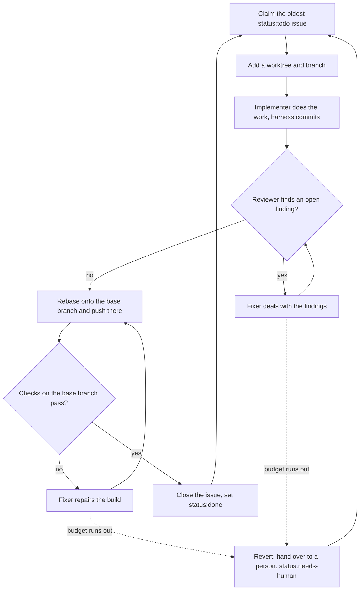

# next-issue

A small harness that works through the open issues of a GitHub repository with the [pi](https://github.com/earendil-works/pi) SDK. Run it inside a git repository.

```bash
npx -y next-issue@latest start
```

## Overview

The harness claims the oldest open issue with the `status:todo` label and gives it its own git worktree and branch. An implementer agent does the work and the harness commits it. A reviewer agent judges the diff, and a fixer agent deals with any open finding, and the review runs again. With no open finding left, the harness rebases the change onto the base branch as one commit, pushes it there with no pull request and waits for the checks of that commit. On a red build the harness reruns the failed jobs of each failed workflow run once, and only a run that fails again goes to the fixer, whose fix lands the same way. When the checks pass, the issue is closed and gets `status:done`. When a budget runs out or the work cannot go on, the issue gets `status:needs-human` and goes to a person. Then the harness takes the next issue.

The harness is built for a flow with as few people in it as possible: people write issues and answer hand-overs, and the harness does the rest. [ADR 0004](https://github.com/ravshansbox/next-issue/blob/main/docs/adr/0004-humanless-flow.md) records this principle, its accepted risks and the setup it recommends.



## What it does

Before each issue, fetch the open issues again and take the oldest one not yet seen in this run. An issue seen once in a run is not tried again in that run while its labels stay as the first fetch after its attempt found them. When its labels change, for example once a person answers a hand-over or makes a skipped issue ready, the next fetch claims it again in the usual order. An issue that is done, or that failed with an error and was not handed over, is not tried again in that run. The run ends when no unseen issue is left. When the fetch fails, the run claims no new issue, ends once the running issues end, writes the summary of the issues it handled and exits with code 1.

`next-issue start` runs the work in the worker of the repository, see [Worker](#worker). It connects to the worker, or starts one in the background (`next-issue serve` of the same version, with its output in `.next-issue/worker.log`) when none answers, and then starts the run there with its flags. It prints the output of the run on standard error and the summary on standard output, and exits with the exit code of the run. When the terminal closes or the command ends some other way, the run keeps going in the worker, and pi and `next-issue logs` still show it. pi shows the run in `/next-issue` and the dashboard, and its Stop, Watch, Hunt and Refresh work on it. When the worker is older than `start` and no run is going, it closes and `start` starts a new one. When a newer client, such as a newer pi, connects while a run of `start` goes, the worker does not stop that run for an upgrade, even when it watches: the run keeps its flags (`--watch on|off`, `--hunt on|off`), `start` follows it to its end, and the worker upgrades once it ends. When a run is going in the worker already, `start` exits with code 1 and the error `a run is going in this repository already`, and leaves that run alone: it does not tell an older worker its version, so the worker does not stop a watching run for an upgrade. `start` ignores `--force`, as before.

Only one worker goes at a time in a repository. It holds the lock `.next-issue/worker.lock`, with the process id and the start time of that process, for its whole life. A run that the worker starts takes no lock of its own, since the worker runs at most one run at a time. When a process that does not take connections on the worker socket holds the lock for more than 2 seconds, `start` starts a worker anyway, which exits with `another worker is running`, so `start` claims no issue and exits with code 1 and the error `the next-issue worker exited before it listened: exit code 1 (see .next-issue/worker.log)`. A lock whose process is gone, or started at another time, is stale and taken over.

Every command uses the main worktree of the repository as its root, the first one that `git worktree list` shows, even when it runs in a linked worktree. So `.next-issue/`, with the config, the locks, the worker socket, the saved state and the notes, and `.worktrees/` are always in the main worktree, and a run or worker started from a linked worktree gets the same refusal as one started from the main worktree.

A run works on up to `concurrency` issues with an agent at the same time, 1 by default. Each claimed issue takes a slot. An approved issue frees its slot while it waits to land, while it lands and while it waits for the checks on the base, so the next issue's agents never wait for CI. When such an issue needs an agent again, for example the fixer for a conflict or for failed checks, it waits for a free slot, takes it before any new issue is claimed and frees it once the agent ends. So no more than `concurrency` agents run at once. When a slot frees up, the run claims the oldest unseen issue for it, and fetches the open issues again only when the last fetch left an unseen issue unclaimed or an issue has ended since. When an issue ends while every slot is taken, the run still reads the open issues again, so the open-issue count stays current, but claims nothing until a slot frees up. The run ends only once every issue has ended, including those waiting to land. Each issue has its own worktree and branch. Step 3 below and the removal of a worktree or branch run for one issue at a time, so two issues never change the git refs or worktrees of the repository at once. An issue skipped as blocked is tried again in that run once another issue is done, so an issue blocked by one that waits to land is claimed once its blocker closes. For each issue:

1. Claim the issue only when it holds the `status:todo` label and holds no `status:in-progress` or `status:in-review` label. A `status:done`, `status:needs-human` or `status:blocked` label always stops the claim, a resume too, except a `status:needs-human` issue with an answer to its hand-over that the run made, and except an issue whose finish a stop cut short and that was not handed over (see step 7 below). An issue that GitHub lists as blocked by an open issue waits, because its blocker closes only when the change of the blocker lands. An issue with saved state under `.next-issue/` resumes instead, whatever its other labels and blockers.
2. Add `status:in-progress` to the issue.
3. Fetch the remote, fast-forward the local copy of the default branch when that is safe, then add a git worktree at `.worktrees/<n>` in the repository root on the `<n>` branch. An issue that resumes from saved state keeps the branch name that the state holds, and a worktree that holds that branch already stays in use. A branch that exists on the remote is the start, and a local branch that fell behind the remote is fast-forwarded; a local branch that cannot be fast-forwarded stays as it is and the harness writes a `branch.behind` event. The fetch prunes remote branches, so a remote branch that was deleted does not count. A local branch that the remote does not hold and that has no commits of its own starts again from the remote base. An issue with no saved state does not reuse a local `<n>` branch: it resets that branch, and any worktree that holds it, to the remote branch, or to the remote base when there is none. A worktree at `.worktrees/<n>` left on a detached HEAD, for example by a crash, is removed, but its uncommitted files are first committed on a `<n>-detached-<sha>` branch, so they are kept. The main worktree of the repository is never used, reset or cleaned: when it has the branch of the issue checked out, the issue fails and is handed over, and the reason asks you to check out another branch there. A fast-forward of the base that is not safe leaves the local base branch as it is and writes a `base.behind` event. A new branch then starts from the remote base.
4. Let the implementer agent do the work, then commit it. For a behaviour change, the implementer writes the test first and quotes its failing output in its reply. The harness keeps that reply in the state file for the reviewer. The branch is not pushed. When a git hook stops a commit, the agent that made the change gets the hook output, fixes it, and the harness commits again. A `commit:` line in the reply of the agent replaces the subject, so a hook that rejects the subject can pass. The harness drops each GitHub closing keyword (`close`, `closes`, `closed`, `fix`, `fixes`, `fixed`, `resolve`, `resolves`, `resolved`) that names an issue from the subject, so a push to the base never closes an issue: the issue closes only after its checks pass. The budget is `maxCommitFixes`. Any other git failure in the commit stops the run with an error. An implementer that makes no change hands the issue to a person, unless the branch is already ahead of the base, for example when an issue resumes from saved state in phase `claimed`, or when the remote holds branch `<n>`: the run then carries on with the commits on the branch, and the newest of them gives the subject of the landed commit. A lost state file does not count, since an issue with no saved state resets its local branch (step 3). When the base already does all that the issue asks, the implementer makes no change and ends its reply with a `done: <evidence>` line. If the branch is not ahead of the base, a reviewer then checks that claim against the base. The harness puts the branch back after this reviewer as it does after the reviewer of step 5, also when it times out, fails or the run stops. When it raises no blocking finding, the harness comments `### next-issue · Worker: already done` with the evidence and the summary of the reviewer, adds `status:done` and closes the issue as completed, and the issue ends as `done`. Otherwise it hands the issue to a person with the reason `already done disputed`, and the comment holds the evidence and the findings of the reviewer. A reply with a `question:` line asks the questions instead. To close a parent issue once its sub-issues land, mark it as blocked by each sub-issue and give it the `status:todo` label: it waits while a sub-issue is open (step 1), then the implementer finds it already done and the harness closes it. The implementer checks the issue first. When the scope, the expected behaviour or the acceptance criteria are ambiguous, it makes no change and asks instead of guessing, with each question on its own `question: <n>. <question>` line, its options labelled by letters and one option recommended. A reply with at least one `question:` line makes the harness drop any change in the worktree, commit nothing and hand the issue to a person with the reason `questions`. The hand-over comment lists the questions in order, numbered by the harness. The harness reads the issue again and adds the questions after any text under its `Open questions` heading, or adds that heading at the end of the body when it has none. When that read or body edit fails, the harness records a `questions.body-failed` event in the run log and still hands the issue over with the questions in the comment. When a person without write access last changed the body, the harness leaves the body as it is, records a `questions.body-untrusted` event and does the same (see [Safety](#safety)). It also keeps the questions in the state of the issue, so the implementer of the run that resumes the issue finds them next to the answer of a person, not in the issue body.
5. Let the reviewer agent judge the diff, at most `diffMaxChars` of it. The reviewer reads files and runs commands in the worktree, so it can prove a finding with the tests or the type check. The harness then throws away every change that the reviewer left in the worktree, so no such change can reach a later commit. When the reviewer left another branch or a detached `HEAD` checked out, the harness checks out the issue branch again at its commit from before the review. It does the same when the reviewer times out or fails. The state file keeps that commit while the reviewer runs, so when the run stops during the review, the next run that resumes the issue first puts the issue branch back at that commit, before the setup command, and the diff it reads holds no reviewer commit. A commit that a person adds to the branch after a hand-over stays on it. The first reviewer also gets the reply of the implementer, and raises a finding when a behaviour change has no failing run of its test. A later reviewer gets the reply of the last review fixer instead, who quotes the failing run of a test for a behaviour change. The reviewer ends its last message with its verdict as a json block: a summary and one entry per finding, each rated `blocking` or `minor`. A reply without a valid block hands the issue to a person. The findings are the only ground truth. The reviewer gives no approve or reject field, because such a field can contradict the findings. The harness puts the result on the issue. A result longer than a GitHub comment (65536 characters) is cut to fit, with a last line that says so.
6. An open finding is any finding, blocking or minor, while a review round is left. In the last round, only a blocking finding stays open: a minor finding there goes on the issue but starts no fix, because a fix in the last round gets no review. Thus `maxReviewRounds` of `1` never fixes a minor finding.
7. No open finding means approval: the change lands on the base branch. Approved changes land one at a time, so the next one waits, without a slot, until the checks of the last one end, and other issues go on meanwhile. The harness fetches the remote base, merges it into the branch and makes the change one commit on top of it, with the subject of the implementer's commit. A review fix keeps that subject, but a commit fix for the implementer's commit replaces it, and a fix for failed checks after the landing lands under the fixer's own subject. The reapply commit after a revert uses the subject of the change. When git merges the base cleanly, no agent runs. When a conflicted file holds no conflict marker, for example a file that one side deletes and the other changes, a renamed file or a binary file that both sides change, no agent runs: the harness undoes the merge and hands the issue to a person with the reason `merge conflict`, since git leaves only one side in the file. When git reports conflicted files, the fixer gets the list from the check budget, `maxCiFixes`, removes the conflict markers, and the harness commits the merge. A merge that the fixer commits itself counts only when the branch then holds the base commit that was merged and the listed files hold no conflict marker. With the budget used up, or when the fixer leaves a conflict marker or the merge unresolved, aborts the merge, or fails, the harness undoes the merge and hands the issue to a person with the reason `merge conflict`. When `checks` lists commands, the harness then runs the setup command again in the worktree, so the checks use the dependencies of the merged base. It runs the setup after it makes the change one commit, and commits what the setup writes, unless git ignores it, on top of that commit without hooks. Every check runs on that setup commit. After the checks, the harness puts the branch back at the change commit, so what this setup writes does not land on the base; after a stop or kill during the checks, the next run puts the branch back first. What the first setup writes, before the implementer, is part of the implementer's commit and lands. When this setup rewrites such a file, for example a lock file, the checks run on the rewritten file, but the base gets the file of the change. A change that the base already holds is an `empty change` before the setup runs. A setup that fails or does not finish in `setupTimeoutMinutes` keeps the merged commit, stops the landing before the push and hands the issue to a person with the reason `setup failed` or `setup timeout`. The harness then runs each command in `checks` in the worktree, in order, with `bash -c` and stderr merged into stdout, each for at most `checksTimeoutMinutes`. Their output goes to the run log (`check.output`, and `check.fail` for a failure). After each command, the harness resets the worktree to the commit it checked and removes untracked files that git does not ignore, so a file that a command writes never lands on the base. A command that fails or does not finish stops the landing before the push: the fixer gets the command and the tail of its output (at most `logMaxChars`) from the check budget, `maxCiFixes`, and its fix is squashed into the change, which keeps its subject. The harness then merges the base again and runs every command again, so nothing lands until all pass. When the budget runs out, the harness hands the issue to a person with the reason `local checks failed: <command>` and the tail of the output in the comment; a fixer that adds no commit or calls the failure unrelated hands it over too, as for the checks on the base. Nothing of the change reaches the base. A run that stops while a command runs keeps the budget, and the next run merges and runs every command again before any push. The state file keeps the merged commit from the squash until the push, so the next run that resumes the issue first puts the issue branch back at that commit, before the setup command. A commit that a person adds to the branch after a hand-over stays on it. The harness then pushes the commit to the base branch, without force. When the push fails, the harness fetches the base first, and treats the push as landed when the base holds the commit, for example after a timeout. When the base moved, for example because someone else pushed first, the harness starts the rebase again, three times at most. When the base did not move, for example on a missing permission or a branch protection rule, the harness hands the issue to a person at once with the reason `push failed`, without running the checks again. Each `push failed` comment holds the tail of the last error of git. When that fetch fails too, the harness hands the issue to a person with the reason `push unknown` and halts, even when the hand-over fails. The state file holds the commit during the push, so a run stopped meanwhile, or the resume after that hand-over (once a person answers or takes the label off), checks the base and waits for the checks of the commit when it landed. Until then, no run lands another change (see below). Once the commit lands, the harness fetches the remote and fast-forwards the local base branch to it when that is safe. A fetch that fails or a fast-forward that is not safe leaves the local base branch as it is and writes a `base.behind` event, and the landing goes on. The harness then waits for the checks of the pushed commit on the base branch: the GitHub Actions workflow runs that a `push` of the base branch started on it, its commit statuses and the check runs of every other GitHub App, so checks from another CI service count too. It leaves out the check runs of the GitHub Actions app, since it judges GitHub Actions by its workflow runs. It leaves out workflow runs that any other event (such as `issues`, `issue_comment` or `schedule`) started, since GitHub gives such a run the tip of the default branch as its commit. It also leaves out the `push` runs that a push of a tag or of another branch started on the same commit, such as a release or a deploy. It leaves out every GitHub Actions job, check run and commit status whose name is in `ignoredChecks`: it does not wait for it, its result does not fail the checks and its logs do not go to the fixer. With `ignoredChecks` set, the harness judges each workflow run by its other jobs, so a run whose only failed job is ignored passes when every other job passes. A run that GitHub concludes `success` passes as it is, so a failed job with `continue-on-error: true` does not fail the checks. When an ignored job fails and GitHub cancels another job of the same run, for example through the default `strategy.fail-fast` of a matrix, that job never finished: the harness hands the issue to a person with the reason `main checks cut short` and halts, and the issue stays open. Set `fail-fast: false` on a matrix with an ignored job to avoid this. The same goes when an ignored job fails and another job of the same run ends `skipped`, for example because it `needs` the ignored job; a skipped job in a run with no failed job still passes. A failed or errored commit status, or a workflow run or check run that ends with `failure`, `timed_out` or `action_required`, fails the checks. The harness does not rerun a workflow run that ends `action_required`, since it waits for a person to approve it. When any check ends `cancelled`, for example because a later push cancelled the workflow run, that check never finished, even when another check (such as a release workflow) ends `success`: the harness hands the issue to a person with the reason `main checks cancelled` and halts, and the issue stays open. A repository that reports no check keeps asking for `checkGraceSeconds`. When every check passes, the harness keeps asking until `checkGraceSeconds` have gone by since it first read the checks, since GitHub can add a check a few seconds after the others; a check that shows up in that time counts, and one that shows up later does not. A pending state waits again, up to `checkTimeoutMinutes`. A read that fails is tried three times. When the first read of the checks of a landed change still fails, for example on a rate limit or an expired token, the harness hands the issue to a person with the reason `checks error` and halts, before the next change lands. The comment holds the error and says that the landed commit is on the base and its checks were not awaited. The state file keeps the commit, so the resume after a person answers or takes the label off waits for its checks, and until then no run lands another change (see below). When the checks pass, the harness marks the state file as closing, sets `status:done` and closes the issue. When a run stops or dies before the close, the next run sees the mark, sets `status:done` and closes the issue, with no new push, revert or hand-over. A hand-over clears the mark, so an issue taken back after a failed label edit or close is resumed, not closed, by later runs. When a run stops or dies after the close, before the state file goes away, the next run finds the closed issue through its state file and removes the worktree, the local branches and the state file, with no new push, revert, label, close or hand-over. A label or close that fails for another reason hands the issue over, and it then waits for a person like any other hand-over. Then the worktree, the local branch and the state file go away. When the checks fail, the harness reruns the failed jobs of each failed GitHub Actions workflow run once with `gh run rerun <id> --failed`, records a `ci-checks.rerun` event and waits again once the runs restart. A failed run whose failed jobs were already rerun (its attempt on GitHub is above 1) is not rerun again, so a resumed run reruns only the runs not rerun yet. A failure that gets a rerun ends the wait at once; any other failure (a run that was rerun, a run that waits for approval, a check from another CI service) waits until every check has finished, so a workflow run that fails later, even after the first rerun started, still gets its own rerun before any fixer. A workflow run whose kept job failed while a job in `ignoredChecks` still runs gets its rerun only once the whole run has finished on GitHub, as GitHub refuses to rerun a running run. A rerun that GitHub refuses because the run is already running counts as started. When at least one run restarted and a later rerun or read fails, the event carries the error and the harness still waits for the checks again, counting each restarted run as running until a later attempt of it completes, so the fixer never runs while a rerun is queued or in progress. When the rerun cannot start (no run restarted, a `ci-checks.rerun-failed` event), or the checks fail again with no run left to rerun, the fixer gets their logs from the check budget (for a check from another CI service, only its name and link), and its fix lands the same way. When the fixer cannot fix them, its fix cannot land, an error stops the fix, or the budget runs out, the harness reverts every commit of the change on the base branch, pushes the revert and hands the issue to a person. When the push of the fix ends as `push unknown`, the harness does not revert: it hands the issue over and halts as for any other `push unknown`. A revert push that the remote refuses, for example because the base moved, makes the revert again on the new base, three times at most. A failed revert push that the base holds after a fetch counts as landed. Once the revert lands, the harness fast-forwards the local base branch to it, as after a landed commit. When that fetch fails too, the revert may be on the base with checks nobody awaited: the harness reports it so, saves the halt and blocks later landings. The state file holds the revert commit during the push, so a run stopped meanwhile checks the base on resume. When the base holds the revert, the harness puts the change back on the branch on top of the revert, as after a revert that completes (an unlanded fix commit is dropped), drops the landed commits from the state, waits for no checks, does not revert again, hands the issue to a person with the reason `revert stopped` and halts. A resume that stopped while the checks of a landed commit ran waits for them again, even when more commits landed on the base since, and a fix that was committed but not landed lands first. Before that, the resume drops any change left in the worktree, including a merge of the base that a stopped fix landing left in progress, so the fix merges the current base again from the start. A problem that the reviewer leaves out of the findings thus gets an approval: only the findings count.
8. With an open finding, run the fixer agent and go to step 5 again. The budget is `maxReviewRounds`. A fixer that holds every finding to be wrong changes nothing and gives its reason instead. The reason goes on the issue and into the next round, where it answers every finding of its own round, so the reviewer withdraws them all or repeats them all. With only some findings wrong, the fixer fixes the correct ones, and the next round holds the rest. A fixer that settles every finding with no code change, for example by showing a failing test run, changes nothing and ends with a `resolved:` line instead. The note goes on the issue and into the next round in the same way, and a change it leaves behind is handled as for a dispute.

## Issue format

Every agent prompt holds the body of the issue and the comments of users with write or admin access to the repository. An issue reads best with these sections, in this order:

1. `Problem`
2. `Context and findings`
3. `Acceptance criteria`
4. `Out of scope`
5. `Open questions`, empty when the issue is created

The list lives in `src/issue-format.mts`. The `create-issue` skill of [`@ravshansbox/pi-next-issue`](../pi-next-issue) writes an issue in this format, and a contract test fails when its template and the list disagree. The harness does not reject an issue without the format.

## Rules for the agents

The implementer and the fixer get these rules in their prompt, and the first reviewer checks them:

- update the documentation for a change of behaviour or a feature that is added or removed;
- remove the tests of a feature or behaviour that is removed;
- test behaviour that a user can observe, and give each test a description that names the actor, the action and the observable outcome;
- reuse existing code and patterns, stay consistent with the repository and pick the simpler option;
- check an API, a command or a url in the repository or its dependencies before using it, and invent none.

The reviewer rates a missing documentation update or a test that is not observable as a finding. In every round, it gives the file and line, or the command output, that supports each finding. Personal style rules, such as spelling, code comments or binding names, belong in the `AGENTS.md` of each repository.

## Stops for a loop

The harness hands the issue to a person, with the `status:needs-human` label, and comments the reason on the issue, when:

- the check budget or the review budget runs out. A finding that the reviewer repeats, even one that the fixer disputed or settled, goes back to the fixer until the review budget runs out;
- a fixer round adds no commit and gives no reason, so there is no progress;
- the fixer reports that the checks fail for a reason the change did not cause, such as a test already broken on the base branch or one that fails only under load. It changes nothing and the reason reaches the issue, rather than the fixer spending its whole budget on a failure it cannot fix. The revert of the change reuses the worktree, so a change the fixer leaves behind does not stay there: its edits are committed with no hooks on top of any commit of its own, that commit moves to a new local `<n>-dispute-<commit>` branch, and the hand-over comment names that branch. The branch goes away with the `<n>` branch when the issue is done. For the checks on the base, a failure in a file that the change added or changed is never unrelated: when the failed logs name such a file (by its path, or by a tail of its path that keeps a folder and has no folder before it, so `packages/a/src/index.ts` does not name `packages/b/src/index.ts`), the harness refuses the claim and gives the fixer another round from `maxCiFixes`, with a note that names the file. A later hand-over comment of the same run, such as for a fix that fails its checks too or fails to land, still names the dispute branch of each refused round;
- a fixer disputes or settles the findings and leaves a change behind, either in the worktree or in a commit of its own. A dispute carries a reason, not a diff, and a retry of the issue cleans the worktree before the next review, so the change does not stay there: its edits are committed with no hooks on top of any commit of its own, that commit moves to a new local `<n>-dispute-<commit>` branch, and the hand-over comment names that branch. The `<n>` branch keeps only what will land, and the reviewer of a retry sees none of the change. Neither lands. The `<n>-dispute-<commit>` branches go away with the `<n>` branch when the issue is done;
- the reviewer gives no verdict, or the checks do not finish in time;
- a command in `checks` still fails before the push when the check budget runs out; nothing of the change is pushed;
- the push to the base branch fails while the base did not move, or fails three times;
- the checks on the base branch fail and the fixer cannot fix them, an error stops the fix, or they do not finish in time. The base branch is then broken, so the run claims no new issue and ends once the running issues end. It halts this way even when the hand-over fails; the issue then ends in error with both the reason and the hand-over error;
- the implementer asks questions about the issue (reason `questions`);
- a person without write access last changed the title or body of the issue (reason `untrusted editor`, see [Safety](#safety));
- an agent does not finish in `agentTimeoutMinutes`;
- the setup command fails, or does not finish in `setupTimeoutMinutes`. On a resume whose state holds a landed commit, or a push or revert that may have reached the base, the setup runs before the harness checks the base, so it then also halts the run, with the commits and state kept for the next run. The comment says what may be on the base and that its checks were not awaited;
- a step of the run fails with an error. A `gh` call that is safe to repeat, such as a read or a label edit, is tried up to three times first when the network fails. So is a `gh run rerun`: when GitHub took the first try, it refuses the next as already running, which counts as a started rerun. A `gh issue comment` is tried once, so a lost reply never makes a duplicate. On a resume whose state holds a landed commit, or a push or revert that may have reached the base, an error before the harness checks the base (for example a failed fetch of the base, or a worktree that cannot be made) also halts the run, as `push unknown` does. The issue ends in error, the comment says what may be on the base and that its checks were not awaited, and the state keeps the commits for the next run.

After a halt, a running issue that reaches the landing does not land on the broken base branch: it ends `stopped` with the reason `run halted` and keeps its state, branch and labels. The next run resumes it and lands it with no new review.

A halt that leaves a commit on the base, or a push or revert that may be on it, with checks nobody awaited (`checks error`, `push unknown`, `main checks timeout`, `main checks cancelled`, `main checks cut short`, an error or a failed setup on such a resume before the base is checked, or a stop or kill while the run pushes a change to the base, waits for the checks of a commit it landed, or fixes the failed checks of that commit before the fix lands or the revert of that commit ends) is saved in the state file of its issue. A stopped issue resumes in the next run; any other waits for a person, so later runs skip it. Either way, no later run lands another change meanwhile: an issue that reaches the landing ends `stopped` with the reason `base unchecked`, keeps its state, branch and labels, and the run claims no more issues; the log holds a `land.blocked` event with the waiting issues. Runs take such a halted issue before the others, and a running one still resumes, so an older issue that reaches the landing first does not keep it from checking the base. Once a person answers or takes the label off, the issue resumes, checks the base and waits for the checks of its commit; when those are known (the issue is done, or its commits are reverted or found not on the base), the issue drops the halt from its state and the next run lands the held issues again. A later landing of that issue blocks other runs only if it halts again. A person who gives such an issue up instead (the `skip` label, which **Give up** in pi adds) releases the block: the next run skips the issue, drops its halt from the state and logs a `land.released` event, so other issues land again on a base whose last checks nobody read. The state keeps the commits, so taking the `skip` label off later resumes the issue and checks them. Such a resume is not held back by another halted issue while it only checks its commit already on the base; a fix it has to land waits like any other change. The hand-over comment says so. A halted issue that was deleted or moved to another repository can no longer be answered or given up, so the next run that gets a not-found error when it reads the issue releases it the same way: it drops the halt from the state, keeps the commits and logs a `land.released` event with the reason `issue not found`. Any other read error (for example a network error) keeps the block for that run.

The fixer sees the findings of all earlier rounds, not only the last one, with its own disputes next to them. From round two, the reviewer judges only the earlier findings and any regression.

Each comment that the worker posts on the issue starts with one heading line of the form `### next-issue · <Agent>: <outcome>`, with the details below it: `### next-issue · Review: approved`, `### next-issue · Review: changes requested`, `### next-issue · Fixer: no change`, `### next-issue · Fixer: settled with no change`, `### next-issue · Worker: already done` and `### next-issue · Hand-over: needs help`. The account is the same for all of them, so the heading, not the author, tells them apart. A comment longer than 65536 characters is cut to fit and ends with the line "This comment was too long for GitHub and was cut." The agents get no comment that starts with `### next-issue ·` or with a heading of older versions (`next-issue needs help:`, `### Review:`, `### Fixer:` and `### Already done`), so a comment of an agent never returns to a prompt: the dispute of the fixer reaches the reviewer through the state file. The one exception is the answer to a hand-over, see [Retry an issue that waits for a person](#retry-an-issue-that-waits-for-a-person).

## Stop a run

Press `Ctrl-C` to stop a `next-issue start` run step by step. Each press asks the worker to stop the run, as `stop` does (see [Worker](#worker)):

1. The first press stops new claims. The harness finishes every issue that it holds and then writes the summary as usual.
2. The second press stops every running issue after its current round: the implementation or one review round (review, then fix). An issue that lands goes on until its checks on the base branch end. The issue ends as `stopped`. Its state, worktree and labels stay, so the next run carries on from that point.
3. The third press stops every agent, kills the command that runs and every child of it, so each running issue stops in the middle of a step and ends as `stopped`. The saved state lets the next run continue the issue. A fourth press ends `next-issue start` at once, and the run ends in the worker as after the third. Edits that an agent did not commit stay in the worktree. When the issue resumes in review, the harness drops them before the reviewer starts, so the reviewer sees only the commits of the branch. Files that git ignores, such as build output, stay. When it resumes before the first commit, the implementer runs again and the commit holds them. A review round or a check fix whose reviewer, fixer or read of the failed logs this press kills does not count, so the next run runs that step again with the same budget. A rerun of the failed jobs on the base branch that this press kills before any job restarted runs again in the next run, before any fixer.

`SIGTERM` or `SIGHUP` (its terminal or ssh session closes) to `next-issue start` ends only that command; the run goes on in the worker. `SIGTERM`, `SIGHUP` or `SIGINT` to the worker (`next-issue stop` sends `SIGTERM`) act like the third press: they stop the running harness commands and agents, with the commands the agents started, and give back the review round, the check fix and the rerun in the same way.

When the reviewer approved the change and the run stopped before its commit reached the base branch, the next run drops those edits and any unfinished merge of the base branch, then lands the change with no new review round. A hand-over of the issue cancels that approval, so the issue resumes in review. A revert of the landed change cancels it too, even when the hand-over after it does not finish.

Signals that arrive within 100 ms of the last counted one count as one press, because `npx` and `npm exec` pass on a press as a second signal.

Each of the first two presses prints a line that says what happens next. The agents run inside the harness, and their commands and the harness commands run in a process group of their own, so a press reaches only the harness.

The harness runs all git and `gh` commands itself. The commit holds all the changes in the worktree, so a setup command that writes a file that git does not ignore puts that file in the commit. The reviewer is the one agent whose changes never get that far: the harness discards them, undoes any commit that the reviewer made on the issue branch and checks that branch out again, before it reads the verdict.

## Safety

Every agent can run a shell command. The implementer and the fixer run with the permission checks off; the reviewer runs with a smaller tool set, but its shell has no limit on the commands. They all start in the worktree, but nothing holds them there: they can run any command, with your rights, anywhere on the machine. The prompt holds the title and the body of the issue, which come from GitHub. It also holds the comments of the issue, but only those by users with write or admin access to the repository. The harness leaves out every other comment and writes a `comment.skip` event with its author to the run log. If an access check fails for a reason other than a 404, the issue stops with an error.

After the setup, and before any agent runs, the harness finds the last person to change the body (the author when nobody edited it) and the last person to change the title (the author when nobody renamed it). When either has no write or admin access, no agent gets the issue: the harness hands it to a person with the reason `untrusted editor`, and the comment names each such person. The agent gets the title and body read in the same query as their editors, so an edit made after the harness listed the issue is never sent unchecked. A writer who checks the text and then changes the named title or body makes the issue go on after the answer. This matters most on a public repository: anyone can open an issue there, and its author can edit the body after a maintainer adds the ready label, before the harness claims it. An issue opened by a person without write access thus always waits for a writer to change it. When the implementer asks questions, the harness writes them into the body only when a writer last changed it; otherwise the body edit would make the harness its last editor and pass the unchecked text. It hands the issue over with the questions in the comment instead, and the run that resumes it after the answer hands it over again with the reason `untrusted editor`.

The prompt puts the body of the issue, check logs, hook output, the diff and the replies of other agents inside `untrusted` fences, each longer than any backtick run in its text, and tells the agent to treat that text as data, not instructions. The comments of writers, and a writer's answer to a hand-over, stay outside the fences.

Thus a writer can still give an instruction to the agent, and the agent can read other text, such as linked issues or files, by itself. Use the harness only on a repository where you trust the writers, or run it in a container.

[ADR 0001](https://github.com/ravshansbox/next-issue/blob/main/docs/adr/0001-reviewer-isolation.md) records why the reviewer keeps a full shell, and which other options were considered.

No person checks a change before it lands. To replace those checks, [ADR 0004](https://github.com/ravshansbox/next-issue/blob/main/docs/adr/0004-humanless-flow.md) recommends a non-empty `checks` gate, a different model for the reviewer than for the implementer and the fixer in `models`, and running the whole harness in a container.

## Observability

Every run has an id, `<timestamp>`, and writes these under `.next-issue/runs/`:

- `<id>.jsonl` — one JSON object per event, with `ts`, `runId`, `kind`, and the `issue`, `role` or `round` in scope. A run whose fetch of the issues fails ends with an `issues.fail` event. A run that fails in any other way once this file is open, for example when `gh repo view` fails at the start or an issue crashes the run, ends with a `run.fail` event (after `run.end` when the run got that far). Both carry the `error`;
- `<id>.summary.json` — token totals per agent role, event counts, and one report per issue with the outcome, the reason and the budgets used (in a watch run, an issue skipped in several passes gets one report, and an issue handled in more than one pass keeps a report for each; when an issue crashes the run, the file still holds the reports of the issues that finished);
- `<id>/sessions/` — the full pi session of each agent call, with every message, tool call and tool result. The session id in a `usage` event is part of the file name.

At the start of a run, the harness deletes the files and folders under `.next-issue/runs/` that are older than `keepRunDays`. The age of a folder is the time since the last change to it or to anything inside it, so the sessions of a long run stay while it still writes them. Set the field to `0` to keep them all.

A short text summary of the same data goes to standard output. All progress goes to standard error.

Recorded for each step: `claim`, `comments`, `reply`, `worktree`, `setup`, `editors`, `implement`, `review`, `fix`, `commit-fix`, `rebase`, `land`, `ci-checks`, `revert` and `hunt`, each with a `.start`, `.end` or `.error` event and a duration in `ms`. Every `git` and `gh` command is recorded with its exit code and duration. A `tool` event holds the tool name. For a `bash` tool it holds the command too, and for a `read`, `write`, `edit`, `grep`, `find` or `ls` tool the `path` it got, relative to the worktree when inside it. Each agent call adds a `usage` event with the tokens, the turn count, the tool-call count, the model and the session id. A call that times out, ends with a model error or is stopped after its session started adds one too, and its tokens count in the summary totals.

```bash
jq -r 'select(.kind=="usage") | [.issue,.role,.turns,.total] | @tsv' \
  .next-issue/runs/*.jsonl
```

`next-issue logs` shows the newest run log, one readable line per event, and then prints new events as the run adds them, until `Ctrl-C`. In a terminal it starts with the last events that fit the screen; in a pipe it starts with all of them. It stops when the reader of the pipe closes it; on Linux it notices this only at the next event. When the worker restarts and starts a new run log, `logs` prints the rest of the old one, then a line `— new run: <file name> —`, then every event of the new one. This also shows a run of the worker, whose progress goes to no terminal.

The console shows the run and issue milestones, verdicts, hand-overs, errors, each step end, each tool call and failed commands. It leaves out each step start, each command that succeeds, the output of the checks and the agent text; the run log and the sessions hold them.

## Requirements

- Node 24 or later
- git 2.40 or later (every commit runs `git hook run`, every conflict with the base runs `git check-attr --source`). A run or `serve` run on an older git stops before it claims an issue, with an error that names both versions.
- `gh`, authenticated with write access to the repository
- a `remote` on GitHub: `github.com`, or a GitHub Enterprise host. Every `gh` call names the host of the remote url (`--repo <host>/<owner>/<name>`, `gh api --hostname <host>`) when it is not `github.com`, so `gh` must be logged in to that host. For an ssh url the harness reads the real host of an ssh alias with `ssh -G`. The host `ssh.github.com` (GitHub's ssh over port 443) means `github.com`. Other hosts, such as GitLab, are not supported.
- pi, logged in to a model provider. The agents use the model, the thinking level, the extensions and the skills from your pi settings, except the extension and the skills of the `pi-next-issue` package. A repository under a folder named `pi-next-issue` keeps its project extensions and skills. The implementer and the fixer get the default tools of your pi settings, the `grep`, `find` and `ls` tools and the tools of your extensions. The reviewer gets all of them except `edit` and `write`. The agents run with `GIT_OPTIONAL_LOCKS=0`, so a `git status` from an agent or an extension does not hold the index lock while the harness commits. While an agent runs, `process.argv[1]` is the pi CLI, so an extension that starts a child pi with `process.execPath` and `process.argv[1]` (such as a `subagent` tool) runs pi, not next-issue.

## Configuration

To write the file with the defaults, run the `init` command in the repository:

```bash
npx -y next-issue@latest init
```

The command writes `.next-issue/config.json` in the main worktree and adds `.next-issue/` and `.worktrees/` to `info/exclude` in the git directory, which linked worktrees share. It removes those two lines from `.gitignore`, and deletes `.gitignore` when nothing else is left in it. It moves a `next-issue.config.json` in the root to `.next-issue/config.json`; every other command stops while that old file is there. It stops when the config file is there already; `--force` replaces it. The file holds no `setupCommand`, because the harness deduces one from the lock file of the project.

`start` and `serve` also add the two lines to `info/exclude` and remove them from `.gitignore`, so a repository needs no `init` to run. They do not create the config file.

The harness writes its JSON files (the config file, the state files and the run summary) with the keys sorted alphabetically at every level. Each run that `start` or `serve` begins sorts the keys of an existing config file the same way, and sorts `ignoredChecks`; it keeps the fields and values you wrote, adds no default and keeps the order of `checks`. It leaves a file that is already sorted, or that stops the run, untouched.

With no file, every field keeps its default. A field that is not in the file keeps its default. A file that cannot be read, a file that is not valid JSON, a field with a value of the wrong type and a field name that the harness does not know all stop the run, so a typo cannot pass without a word. An old `draftPullRequest` field stops the run with an error that says to remove it, because no pull request is opened.

```json
{
  "agentTimeoutMinutes": 30,
  "checkGraceSeconds": 60,
  "checkIntervalSeconds": 15,
  "checkTimeoutMinutes": 60,
  "checks": [],
  "checksTimeoutMinutes": 30,
  "commandTimeoutMinutes": 10,
  "concurrency": 1,
  "diffMaxChars": 60000,
  "huntCap": 1,
  "ignoredChecks": [],
  "issueLimit": 100,
  "keepRunDays": 7,
  "labels": {
    "done": "status:done",
    "hunt": "source:hunt",
    "inProgress": "status:in-progress",
    "inReview": "status:in-review",
    "needsHuman": "status:needs-human",
    "ready": "status:todo",
    "skip": "status:blocked"
  },
  "logMaxChars": 20000,
  "maxCiFixes": 5,
  "maxCommitFixes": 10,
  "maxReviewRounds": 5,
  "models": {
    "fixer": null,
    "implementer": null,
    "reviewer": null
  },
  "remote": "origin",
  "setupTimeoutMinutes": 15
}
```

| Field                   | Default            | Effect                                                                                                                                                                                                                      |
| ----------------------- | ------------------ | --------------------------------------------------------------------------------------------------------------------------------------------------------------------------------------------------------------------------- |
| `agentTimeoutMinutes`   | `30`               | The limit for one agent call, opening its session included, at most `35791`                                                                                                                                                 |
| `checkGraceSeconds`     | `60`               | The time to wait for the first check to show, and for more checks after they all pass; the grace ends at the `checkTimeoutMinutes` limit, where checks that all pass, or no checks, still count as a pass                   |
| `checkIntervalSeconds`  | `15`               | The time between two check states, at most `2147483`                                                                                                                                                                        |
| `checkTimeoutMinutes`   | `60`               | The limit for one check wait, at most `35791`                                                                                                                                                                               |
| `checks`                | `[]`               | Shell commands that must pass in the worktree, in order, before an approved change is pushed; a failure goes to the fixer                                                                                                   |
| `checksTimeoutMinutes`  | `30`               | The limit for one command in `checks`, at most `35791`                                                                                                                                                                      |
| `commandTimeoutMinutes` | `10`               | The limit for one `git` or `gh` command, at most `35791`                                                                                                                                                                    |
| `concurrency`           | `1`                | The most issues that an agent works on at the same time; an issue waiting to land or for checks holds no slot                                                                                                               |
| `diffMaxChars`          | `60000`            | The maximum length of the diff that the reviewer reads                                                                                                                                                                      |
| `huntCap`               | `1`                | With `--hunt on`, the hunter hunts only while fewer ready issues than this wait besides the running ones                                                                                                                    |
| `ignoredChecks`         | `[]`               | Names of GitHub Actions jobs, check runs and commit statuses, such as `release`, that the checks on the base branch do not wait for and whose failure does not count, unless GitHub cancels or skips another job of its run |
| `issueLimit`            | `100`              | The maximum number of open issues to read. With `labels.ready` set, only issues with the ready, in-progress or in-review label count                                                                                        |
| `keepRunDays`           | `7`                | The number of days to keep the run files; `0` keeps them all                                                                                                                                                                |
| `labels`                | see above          | The names of the labels that the harness reads and sets                                                                                                                                                                     |
| `logMaxChars`           | `20000`            | The maximum length of the failed job logs, shared between the failed GitHub Actions runs (failed external checks are listed by name and link only)                                                                          |
| `maxCiFixes`            | `5`                | The budget for check fixes per issue                                                                                                                                                                                        |
| `maxCommitFixes`        | `10`               | The budget for fixes of a commit that a git hook stopped, per issue                                                                                                                                                         |
| `maxReviewRounds`       | `5`                | The budget for review rounds per issue                                                                                                                                                                                      |
| `models`                | `null` per role    | The pi model per agent role, as `provider/model`: `implementer`, `reviewer`, `fixer`                                                                                                                                        |
| `remote`                | `origin`           | The git remote for the repository and the branches                                                                                                                                                                          |
| `setupCommand`          | from the lock file | A shell command to run in a new worktree, before the implementer, and after each merge of the base before the `checks`                                                                                                      |
| `setupTimeoutMinutes`   | `15`               | The limit for the setup command, at most `35791`                                                                                                                                                                            |

The hunter adds `labels.hunt` to each issue it files, so you can tell those issues apart from your own and filter them.

The names in `labels.ready`, `inProgress`, `inReview`, `done`, `needsHuman`, `skip` and `hunt` must be distinct, also when case is ignored; two equal names stop the run with an error that names both fields.

An empty `labels.ready` turns the ready requirement off. The harness then claims every open issue that no other label holds back. A run then writes a `labels.ready.empty` warning to the log at start.

The harness compares the labels on an issue with the configured names without case, as GitHub does, so `Status:Todo` counts as `status:todo`.

The log gives the reason for a skipped issue as `stop-label`, `not-ready`, `in-flight` or `blocked`, the last one with the open blockers.

A role set to `null`, or with no entry in `models`, uses the default model of your pi settings.

Without a `setupCommand`, the harness looks for a lock file in the new worktree, and in the worktree after each merge of the base before the `checks`, and runs the install command that goes with it:

| Lock file               | Command                                                                              |
| ----------------------- | ------------------------------------------------------------------------------------ |
| `pnpm-lock.yaml`        | `pnpm install --frozen-lockfile`                                                     |
| `package-lock.json`     | `npm ci`                                                                             |
| `yarn.lock`             | `yarn install --frozen-lockfile`, or `yarn install --immutable` with a `.yarnrc.yml` |
| `bun.lock`, `bun.lockb` | `bun install --frozen-lockfile`                                                      |
| `Cargo.lock`            | `cargo fetch --locked`                                                               |
| `go.sum`                | `go mod download`                                                                    |
| `uv.lock`               | `uv sync --locked`                                                                   |
| `poetry.lock`           | `poetry install`                                                                     |
| `Gemfile.lock`          | `BUNDLE_FROZEN=true bundle install`                                                  |

The first match in that order wins. A project with no lock file in the list runs no setup, and a `setupCommand` in the config file always wins. Thus the agents find a worktree with its dependencies in place, and the reviewer can run the tests. Each command holds to the lock file, so a lock file that does not match the manifest stops the issue rather than changing the lock file. The exception is `go mod download`, which can add missing sums to `go.sum`.

A `setupCommand` that fails, or that does not finish in `setupTimeoutMinutes`, hands the issue to a person. The wait for the checks has its own limit, so `commandTimeoutMinutes` holds for every other `git` and `gh` command. State per issue goes to `.next-issue/<issue>.json`, so a new run continues where the last run stopped. The harness writes a state file to a temporary file in the same folder and renames it over the old one, so a state file is replaced in one step: a run killed or a disk that fills up during a write leaves the earlier state. A state file that is not valid JSON, or that does not hold a valid state, gives the issue an `error` outcome that names the file, rather than a silent skip.

Every agent prompt holds `.next-issue/notes.md` when it exists, so lessons such as test commands, tool quirks and deliberate behaviour carry over from one issue to the next. The implementer and the fixer may add a short note to it, and the prompt asks them to keep only what still holds. The reviewer and the hunter only read it.

Every agent also reads each `AGENTS.md` that pi finds, such as the one in your home folder and the one in the repository. The other rules there, such as code conventions and test style, still apply. But the harness owns the issue, the worktree, the branch, git, the commit, the push and the checks, and the prompt says so: a workflow rule in `AGENTS.md` about these, such as "push to main" or "watch ci", does not apply to the agent. The hunter still files its issues with `gh issue create`.

## Retry an issue that waits for a person

When the implementer makes no change, the hand-over comment holds its full reply after the note, so its reasons and questions can be answered on the issue. When it asks questions on `question:` lines, the comment lists them instead. Every hand-over comment is cut to fit a GitHub comment, whatever the reason, so a long reply or a long run error does not lose it. The reason goes in the body under the `### next-issue · Hand-over: needs help` heading. A cut comment ends with the line "This comment was too long for GitHub and was cut."

A hand-over marks the state file as handed over once its label and comment reach GitHub. When either fails, or the run stops during it, the state keeps its budgets and findings, and a later hand-over of the issue keeps the first reason. A handed-over issue carries the `status:needs-human` and `status:todo` labels, and the hand-over takes `status:in-progress` and `status:in-review` off. With an empty `labels.ready`, it carries only `status:needs-human`. The ready label lets a run find the issue again even when its state file is lost. To give the issue another try, take the `status:needs-human` label off, or answer the hand-over. The next run that claims the issue puts the budgets and the findings back to zero, clears the mark and keeps the branch and the step that the last run reached, so the work carries on where it stopped. After a revert, the branch holds the change again on top of the revert, so the change goes back to the review. An issue that still has the label is not claimed, unless it has an answer to the hand-over: then the run claims it and takes the label off. A label that a person adds to a stopped issue that is not handed over holds the issue, even when an earlier hand-over has an answer. When the label of a hand-over reaches GitHub but its comment does not, an answer to an earlier hand-over does not count: the issue waits, and the worker lists it, until a person takes the label off or a writer comments after that hand-over. Either way, the next run that claims it counts it as a hand-over: it puts the budgets and the findings back to zero and passes on the comments posted after it. When the label edit itself fails, the next run keeps the budgets and the findings.

To give guidance, answer the hand-over with a comment on the issue. When the run resumes the issue, it reads the comments posted after its last `### next-issue · Hand-over: needs help` comment there, or its last `next-issue needs help:` comment, the one-line heading of older versions. Only comments from users with write access to the repository count, for the hand-over comment too. A comment that starts with one of the headings of the harness never counts as an answer. The implementer and every fixer of that run get them in their prompt, under the heading `Answer of a person to the hand-over`. When the questions of the implementer did not reach the issue body, the implementer also gets them under that heading, before the answer, or alone when no comment answers them. A short reply such as "ready, take it" is enough. With no such comment, the run resumes with no guidance.

To drop an issue instead, close it. The next run that finds a saved state for an issue that a person closed removes that state file, the `<n>` branch, the `<n>-dispute-*` branches and the worktree of the issue. This holds for an issue that waits for a person and for one that a stop left behind. The run starts no agent and makes no push, revert, label change, close or comment, so a change that already landed stays on the base branch. A worktree or branch that cannot be removed stays, and the run log says so. The issue shows as `skipped` (`closed`) in the summary. A watching run does not claim an issue again once it ended in `error` in that run, so it leaves such an issue for the next run to clean up.

## Commands and options

| Argument          | Effect                                                                                                                                     |
| ----------------- | ------------------------------------------------------------------------------------------------------------------------------------------ |
| `start`           | Start a run: claim issues, fix them and push them to the base branch                                                                       |
| `watch on\|off`   | Switch watching of the going run, see [Watch for new issues](#watch-for-new-issues)                                                        |
| `hunt on\|off`    | Switch hunting of the going run, see [Hunt for bugs](#hunt-for-bugs)                                                                       |
| `init`            | Write the config file with the defaults                                                                                                    |
| `serve`           | Run the worker of this repository that pi extensions talk to, see [Worker](#worker)                                                        |
| `stop`            | Stop the worker of this repository, see [Worker](#worker)                                                                                  |
| `logs`            | Show the latest run log and follow it, see [Observability](#observability)                                                                 |
| `--force`         | Replace an existing config file, with `init`                                                                                               |
| `--watch on\|off` | With `start`: on reads the open issues again after each pass, off does one pass and ends. On by default                                    |
| `--hunt on\|off`  | With `start`: hunt the repository for bugs alongside the issues, see [Hunt for bugs](#hunt-for-bugs). Off by default. On needs watching on |
| `--help`          | Show the option list                                                                                                                       |

`--watch` and `--hunt` belong to `start`, and any other command refuses them. Each takes `on` or `off`: with no value or another value, `start` fails with `--watch takes on or off` (or `--hunt`) and exits with 1. `--hunt on` with `--watch off` fails with `hunting needs watching` and exits with 1. `next-issue` with no command prints the option list on standard error, starts nothing and exits with 1.

`next-issue watch on|off` and `next-issue hunt on|off` switch the run that is going in the worker of this repository, as Watch and Hunt in pi do, with no restart. They print the new settings, such as `next-issue: watching on, hunting off`, and exit with 0. `watch off` also turns hunting off, and `hunt on` also turns watching on. When no worker or no run is going, they print `next-issue: no run is going in this repository`, change nothing, start no worker and exit with 0. With no value or another value, they fail with `watch takes on or off` (or `hunt`) and exit with 1. When the worker is older than the command, they fail and exit with 1, since an older worker may not answer; stop the run and start it again.

The exit code of `next-issue start` is 1 when an issue needs a person or failed, and 0 when it does not, so a cron job or a CI step can read the result of the run. Since `next-issue start` watches by default and does not end on its own, such a job runs `next-issue start --watch off`.

Versions before 7.0.0 started a run with no command, as `next-issue` or `next-issue --once`. From 7.0.0 a run needs `next-issue start`, and the old form starts nothing and exits with 1. Later versions dropped `--once`: `next-issue start --once` fails with `Unknown argument: --once` and exits with 1, so use `next-issue start --watch off`, which does one pass and ends.

Version 12.0.0 made watching the default: `next-issue start` watches, and `next-issue start --watch off` does one pass and ends, as `next-issue start` did before. `--watch` and `--hunt` now take `on` or `off`, so `--watch` or `--hunt` with no value fails and exits with 1: use `--watch on` and `--hunt on`. Start in pi watches too.

Version 11.0.0 dropped `--max <n>`, `--reset`, `--json`, `--verbose` and `--quiet`. `next-issue start` with any of them, and `next-issue logs --json`, fail with `Unknown argument: <flag>` and exit with 1. Instead:

- for `--max <n>`, take the ready label off the issues that the run should leave, or stop the run with `Ctrl-C`;
- for `--reset`, there is no direct replacement: a handed-over issue still resumes with its budgets and findings at zero once a person answers it or takes the needs-human label off, and closing an issue drops its saved state;
- for `start --json`, read `.next-issue/runs/<id>.summary.json`; for `logs --json`, read `.next-issue/runs/<id>.jsonl`;
- for `--verbose`, read the run log and the sessions under `.next-issue/runs/`; for `--quiet`, filter the output, for example with `grep`.

## Watch for new issues

A run with `--watch off` ends when no unseen issue is left. With `next-issue start`, or `next-issue start --watch on`, the harness then waits, reads the open issues again and runs another pass, so it picks up an issue that someone opens during the run, or one whose blocker closes. Each pass tries every open issue again, also one that an earlier pass skipped. An issue that failed with an error before the claim is not tried again until the next run. An issue that failed after the claim and was handed over with the needs-human label is tried again once a person answers the hand-over or takes the label off. Within a pass, the harness claims a tried issue again at the next read when its labels differ from those it had after its attempt, so an answered hand-over or an unblocked skipped issue does not wait for the next pass. An issue that is done, or that failed with an error and was not handed over, does not come back in the same pass. The hunter counts the same issues as ready.

The waits follow a fixed back-off in minutes: 1, 2, 3, 5, 10, then 10 from then on. A pass that handles an issue, with any outcome other than `skipped`, resets the back-off to 1 minute. A pass where every issue is skipped does not reset it. Each wait prints a line on standard error with the minutes until the next pass.

After each pass that handled an issue, the harness prints the summary of that pass. The token totals in it cover that pass only. The exit code at the end covers all passes.

The watch stops:

- at the first `Ctrl-C` during a wait, at once;
- at the first `Ctrl-C` during an issue, after the running issues;
- after a pass that halts the run, for example when the checks on the base branch failed;
- when the open issues cannot be read.

## Hunt for bugs

With `next-issue start --hunt on`, which needs watching on, the harness runs a hunter agent at the same time as the issues. Before each hunt it reads the open issues with the `labels.ready` label and counts those that are ready to claim and are not running. An issue that failed earlier in the run does not count, since the watch does not try it again. It counts a blocked issue only when each of its open blockers is in the same repository and is running or ready to claim, since those blockers can land and close; a blocker that cannot move, such as one with `labels.needsHuman`, `labels.skip` or `labels.done`, one without `labels.ready`, or one in another repository, leaves it out. It looks only at the direct blockers, and reads them one issue at a time, so it runs one `gh` call at a time. It hunts only while that count is less than `huntCap`, 1 by default. Otherwise it waits and checks again, with the same back-off as the watch: 1, 2, 3, 5, 10, then 10 minutes. After a hunt that files an issue, it waits 1 minute before it checks the count again, even when the count is still less than `huntCap`. Each wait writes a `hunt.wait` event with the `minutes` to the run log. A hunt that files nothing backs off like a failed one. When the harness claims an issue, the hunter wakes: it ends its wait at once, or skips the wait after a hunt that is going, and checks the count again. A wake keeps the back-off where it was. The hunter:

- works in its own worktree at `.worktrees/hunt`, on a detached `HEAD` at the remote base branch, which the harness fetches and checks out before each hunt. A branch that the hunter checks out keeps its commits, and an issue that resumes never uses the hunt worktree as its own;
- follows `next-issue.hunt.md` in the repository root, or a short built-in prompt when the file is missing;
- files up to `huntCap` minus that count, worked out just before the hunt, its most serious findings first, each with the `labels.ready` label, the `labels.hunt` label and the sections of the [issue format](#issue-format), after a search for duplicates. It files and searches with `gh --repo <owner>/<name>` of the configured `remote`, with the host in front when it is not `github.com`, so another GitHub remote, such as `upstream` in a fork, never gets its issues. The `labels.hunt` label, `source:hunt` by default, marks the issue as one the hunter filed. The harness creates the `labels.ready` and `labels.hunt` labels before the hunt when they are missing. It compares label names without case, as GitHub does, so a label that exists in another case, such as `Source:Hunt`, counts as there and keeps its name. When the create fails, it reads the labels again, so a label that someone else created meanwhile counts as there too. It files nothing when it finds no real problem or a duplicate exists;
- runs no test suite and changes no file. It gets the tools of the reviewer.

With `huntCap` at 1 and no ready issue, a hunt files at most one issue. The hunter ends its reply with one `issue:` line for each issue it filed, or one `issue: none` line; a url that is not an issue of the repository of `remote` does not count as filed. When the `remote` url holds an old owner or name that GitHub redirects after a rename or transfer, the harness asks GitHub for the new one, so an issue url with the new name counts too. The run log holds one `hunt.issue` event with the `url` for each, or one with `none`. A hunt that fails writes a `hunt.error` event and the watch goes on. The hunter then waits before the next hunt, with a `hunt.wait` event and the same back-off, so a failure, or a hunt that files nothing, that repeats waits 1, 2, 3, 5, 10, then 10 minutes, and the back-off goes back to 1 minute after a hunt that files at least one issue. The next pass claims the new issues like any other. At the first `Ctrl-C` the hunter stops after its current hunt, and the watch ends once the hunt and the running issues end. A first `Ctrl-C` during the watch wait tells you so while a hunt runs, and the third press stops the hunter at once. The hunter stops too when the watch ends for another reason.

In a run of the `serve` worker, a client can switch hunting and watching on or off while the run goes on, with no restart, for example with `next-issue hunt on` or `next-issue watch off`, or with Hunt on or Watch on in `/next-issue` of the pi extension, see [Worker](#worker). This works for every run, since `next-issue start` runs in the worker too.

## Worker

`next-issue serve` runs one worker for the repository it is run in. The [`@ravshansbox/pi-next-issue`](../pi-next-issue) extension and `next-issue start` start it and talk to it. `serve` takes no flags apart from `--help` and refuses any other with an error, because runs start from a client, not from `serve`. Each repository has its own worker, so the runs, restarts and upgrades of one repository never affect another. The worker:

- listens with WebSocket on the socket file `.next-issue/worker.sock` in the repository. Only your user can open the file. It works on macOS and Linux. When the path of the socket file is too long for the system, about 103 bytes on macOS and 107 on Linux, it exits with an error that says so;
- holds `.next-issue/worker.lock` in the repository, with its process id and the start time of that process, so only one worker goes per repository. A worker that starts while another process holds the lock exits with `another worker is running`. A lock is stale, and is taken over, when no process has that id or the process with that id started at another time, for example because the system gave the id of a worker that was killed or lost in a reboot to another process. A lock without a start time, from an older version, is held while a process with that id is alive, and stale otherwise. A worker that cannot read its own start time exits with an error and takes no lock. When several workers start at once, one takes the lock and the others exit with `another worker is running`. A worker that stops removes the lock file only while it still holds the lock, and the socket file only while it is still the socket it bound;
- refuses a `start`, `stop`, `watch`, `hunt`, `questions` or `upcoming` message whose `root` is not the exact path of its repository with an `error` message, and starts or stops nothing;
- sends each `error` as `{ "type": "error", "root": "<path>", "message": "<text>" }`. When a `start`, `stop`, `watch`, `hunt` or `refresh` message carries an `"id"`, the `error` that refuses it carries the same `id`;
- runs at most one run at a time. A client starts it with `{ "type": "start", "root": "<path>", "args": [...] }`. Each run is like `next-issue start` with those args, or with none when `args` is left out (the pi extension sends none). It takes `--watch on|off` and `--hunt on|off`, and so watches and does not hunt by default, and refuses a command (`start` too), `--force`, `--help` or an unknown argument (such as `--max`, `--reset`, `--json`, `--verbose` or `--quiet`) with an `error` message;
- sends every client the progress of every run when it connects and on every change: for each running issue the issue, the step, the tool count and the last tool, and the handled issues (an issue handled in more than one pass appears once for each);
- sends every client `{ "type": "output", "root": "<path>", "text": "<lines>" }` for each line of a run that `next-issue start` prints on standard error, as the run prints it. The same lines still go to `.next-issue/worker.log`;
- sends every client `{ "type": "pass", "root": "<path>", "summary": {...} }` after each pass of a run started with watching on that handled an issue, with the summary of that pass that `next-issue start` prints;
- sends every client one `{ "type": "end", "root": "<path>", "code": <n>, "summary": {...} }` message when a run ends. `code` is the exit code that `next-issue start` would return for the run, and `summary` is the summary of the whole run, as in `<id>.summary.json` (in a watch run, all passes). A run that fails has `code` 1, no `summary`, and the text that `next-issue start` prints after `next-issue failed: ` in `error`;
- sends every client a `questions` message for each repository: the open issues with the `needsHuman` label, each with its number, title, the reason of the hand-over, the url of the comment that holds it, the `owner/name` repository, and the `needsHuman`, `skip` and `ready` labels. It reads them from GitHub, so the list is the same after a restart. It sends them when a client connects, for its repository, after each issue of a run ends, and when a client sends `{ "type": "questions", "root": "<path>" }`. An issue that no longer has the label leaves the list, and so does an issue whose hand-over has an answer from a writer, the same answer that lets a run claim it. An issue that a person holds with the label stays in the list, even when an earlier hand-over has an answer. An issue with the label but no hand-over comment is in the list with an empty reason and url. The issues are read one at a time. A client never gets an older list after a newer one. When the client adds an `"id"` to its message, the list that answers it carries the same `id` and is read after the message arrived. When the list cannot be read, the client gets `{ "type": "questions-error", "root": "<path>", "message": "<text>" }`;
- answers `{ "type": "upcoming", "root": "<path>" }` with `{ "type": "upcoming", "root": "<path>", "claimable": [...], "blocked": [...] }`: the open issues with the `ready` label that a run would claim, oldest first, each with its `issue` number and `title`, without issues that have saved state or a label that stops a claim. An issue blocked by open issues is in `blocked` with their references in `blockers`. When the list cannot be read, the client gets `{ "type": "upcoming-error", "root": "<path>", "message": "<text>" }`;
- stops a run when a client sends `{ "type": "stop", "root": "<path>", "after": "issue" | "round" | "now" }`. With no `after`, it stops after `issue`. `issue` works like a first `Ctrl-C`: no new claim or hunt, and the held issues and a going hunt finish. `round` works like a second `Ctrl-C`: each running issue stops after its current round, with the state kept, and a going hunt ends first. `now` stops every agent, command and hunt of the run at once, and each running issue ends as `stopped` with its state and labels kept; the worker keeps running. A later point than one already asked for changes nothing, and an earlier one replaces it. An unknown `after` gets an `error` message. While a run is going, the client that sent the stop gets `{ "type": "stopping", "root": "<path>", "waiting": <bool>, "hunting": <bool> }`, with the `id` of the stop when it has one: `waiting` is `true` when the run waited between passes, and `hunting` is `true` when a hunt was going then. `next-issue start` picks its note from it;
- switches watching of a run on or off when a client sends `{ "type": "watch", "root": "<path>", "on": true | false }`. The run keeps its issues, worktrees and progress, and nothing restarts. A run starts with watching on, unless it was started with `--watch off`. On keeps the run going after the current pass, as with `--watch on`. Off ends the run after the current pass, or at once when it waits between passes, and also turns hunting off. With no run going, the message gets an `error` and starts nothing;
- switches hunting of a run on or off when a client sends `{ "type": "hunt", "root": "<path>", "on": true | false }`. The run keeps its issues, worktrees and progress, and nothing restarts. Every run of the worker has a hunter: a run started with `--hunt on` starts with hunting on, and any other run with it off. Off lets a hunt that is going finish, so the issues it files stay, and starts no new hunt. On wakes the hunter at once, with no back-off wait, and also turns watching on. With no run going, the message gets an `error` and starts nothing. The settings last for the run only: a new run takes them from its own flags. The progress of each run carries `hunting`, `true` while hunting is on, and `watching`, `true` when the run watches for issues;
- asks a watching run to check for new issues now when a client sends `{ "type": "refresh", "root": "<path>" }`. A run that waits between passes starts a new pass at once, and its next wait starts again at 1 minute; a waiting hunter checks the ready count again. While a pass runs, the run reads the open issues again, so its open-issue count is current, and claims a new issue only when a slot is free. A refresh for a run that is stopping or does not watch, or with no run going, changes nothing and gets no answer;
- exits, and removes its socket and lock files, when no run is going and no client is connected, or when no client connects in the 30 seconds after it starts;
- waits up to 5 seconds for the lock when a worker that is closing still holds it;
- closes once no run is going when a client with a newer version connects, so that the client can start the newer worker. The `hello` of a client can say how to start the worker of its version, as `"launch": { "command": "<command>", "args": ["<arg>", ...] }`: pi sends `npx -y next-issue@<version> serve`, and `next-issue start` its own `node <script> serve`. A run that watches is stopped between issues for that, as `stop` with `issue` does: it claims nothing new, and its running issues and its current hunt finish. Its progress then holds `"upgrade": { "from": "<worker version>", "to": "<client version>" }`, with `"resumes": true` when the first newer client gave a `launch`. A stop by a person, or turning watching off, drops that field, so the run does not start again. With `resumes`, once the run ends, the worker stops listening, runs that command in the repository with its output in `.next-issue/worker.log` (or uses a worker that already listens there), and asks the newer worker to start the run again with `--watch on` and the same `--hunt` setting, before it closes. This works with no client connected. When the newer worker does not start or does not start the run, the worker writes the reason to `.next-issue/worker.log`, and its clients see the run `failed` with an `error` that starts with `the worker could not start next-issue <version>`. Without `resumes`, a client starts the newer worker and the run again. A run that does not watch, or that `next-issue start` started, is left alone. Meanwhile the worker refuses every start with `the worker is restarting, try again soon`. A `start` with `"resume": true` gets no error when the worker refuses it;
- stops every agent and command and exits on `SIGTERM`, `SIGHUP` or `SIGINT`, and removes its socket and lock files;
- keeps `.next-issue/worker.log`, where the extension writes the output of the worker, within 10 MiB: when it starts and once a minute while it runs, it cuts a log of more than 10 MiB to its newest 5 MiB, from the start of a line. It skips the cut while a command that writes to the log runs. The run logs under `.next-issue/runs/` hold the same events.

Stop the worker of a repository with `next-issue stop` in that repository. Workers of other repositories carry on. This sends `SIGTERM` to the process in the lock file when the lock is not stale, and for a lock without a start time only when the socket of the worker takes a connection, so the worker stops at once and a run that is going resumes from its saved state next time. When no worker is running, the command says so and exits with 0.

Versions before one worker per repository ran one worker for the machine, with `next-issue.sock`, `next-issue.lock` and `next-issue.roots.json` in `~/.pi/agent`, or in the folder that `PI_CODING_AGENT_DIR` names. That worker does not stop by itself, `next-issue stop` does not reach it, and a run in it can claim issues alongside the new worker of the same repository. Stop it once after you upgrade:

```sh
kill "$(cat ~/.pi/agent/next-issue.lock)"
rm -f ~/.pi/agent/next-issue.roots.json
```

## Development

See [Develop](https://github.com/ravshansbox/next-issue#develop) in the root README for the scripts.

`npm run build` compiles `src/*.mts` to `dist/*.mjs`. The package holds the compiled files, because Node does not strip types under `node_modules`.

## Releases

Releases are automatic and need no pull request. Push a [conventional commit](https://www.conventionalcommits.org/) to `main`. The workflow reads the commits since the last tag and picks the bump: `feat` gives a minor, `fix` gives a patch, and a `!` mark or a `BREAKING CHANGE` body gives a major. Any other type releases nothing. The notes of the GitHub release list the subject and short hash of each breaking, `feat` and `fix` commit since the previous tag, grouped by type, and end with the compare link from that tag.

The release is the `release` job of the `ci` workflow, and it runs only after the `check` job of the same commit passes. A commit that fails the typecheck, lint, format check, tests or build releases nothing. As the release is part of the `push` run, the harness waits for it like any other check. Release jobs run one at a time, in the order their `check` jobs finish, which is not always push order. When a later commit releases first, its tag holds the earlier commit and its version counts the commits of both, so the release job of the earlier commit only repairs and does nothing else.

The workflow then gives `next-issue` and `@ravshansbox/pi-next-issue` the same new version and publishes both packages to npm with a [trusted publish](https://docs.npmjs.com/trusted-publishers), so no token is stored. It pushes the tag before the publish and makes the GitHub release after it, so the next release always counts from the new tag and never tries to publish a version that npm already holds, and no release job counts from a tag before one that already holds its commit. npm makes a new version live a few minutes after the publish, and not always in the order it got them, so before it publishes, the job waits until npm serves both packages at the version of the last tag, for up to 10 minutes. Thus a new version never goes live before the one that came before it. Every run first repairs the last tag before its own commit: from a checkout of that tag it publishes each package that npm does not serve at the tag version, and makes the GitHub release if it is missing. A package that npm refuses as a version it already holds, but does not serve yet, counts as published. So when a step fails after the tag push, the next run of a later commit finishes that release before it makes a new one. The release job of an earlier commit that runs after it does not, as it repairs the tag before its own commit. To repair a release without a new commit, run the `ci` workflow by hand; after the checks pass, the release job only repairs and does nothing else. The release job installs with `npm ci --ignore-scripts`, so no install script of a dependency runs with its rights to push and publish. Its actions are pinned to commit SHAs. The publish runs no typecheck and no tests, as the `check` job has run them. So a failing test cannot stop a publish after the tag push. Do not publish by hand: both `package.json` files hold version `0.0.0`, and only the release job sets the real version. Use the `ci` workflow run above instead.

The job uses the npm that comes with Node 24 and never installs another one. Trusted publishing needs npm 11.5.1 or later, so the job stops with an error before anything else when the bundled npm is older. The release job stays on a GitHub runner, because npm takes provenance only from a GitHub runner.
