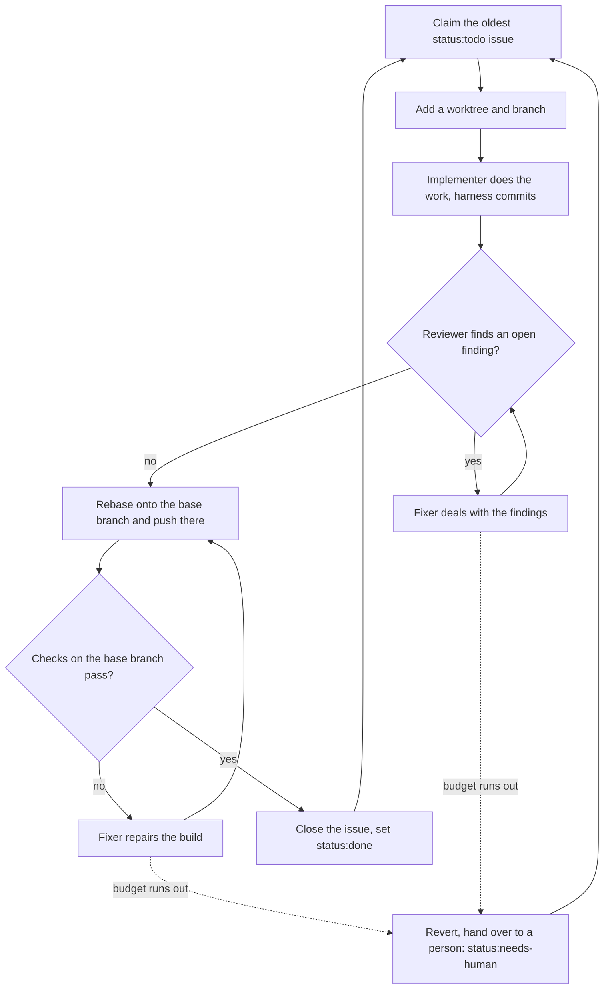

# next-issue

A small harness that works through the open issues of a GitHub repository with the [Claude Agent SDK](https://code.claude.com/docs/en/agent-sdk/overview). Run it inside a git repository.

## Overview

The harness claims the oldest open issue with the `status:todo` label and gives it its own git worktree and branch. An implementer agent does the work and the harness commits it. A reviewer agent judges the diff, and a fixer agent deals with any open finding, and the review runs again. With no open finding left, the harness rebases the change onto the base branch as one commit, pushes it there with no pull request and waits for the checks of that commit. On a red build the harness reruns the failed jobs of each failed workflow run once, and only a run that fails again goes to the fixer, whose fix lands the same way. When the checks pass, the issue is closed and gets `status:done`. When a budget runs out or the work cannot go on, the issue gets `status:needs-human` and goes to a person. Then the harness takes the next issue.

The harness is built for a flow with as few people in it as possible: people write issues and answer hand-overs, and the harness does the rest. [ADR 0002](https://github.com/ravshansbox/next-issue/blob/main/docs/adr/0002-humanless-flow.md) records this principle, its accepted risks and the setup it recommends.



## Install and quick start

You need Node 24 or later, git 2.40 or later, `gh` logged in with write access to the repository, a `remote` on GitHub and Claude Code, logged in. The repository needs a root `package.json` with the scripts `format`, `lint`, `typecheck` and `test`, each of which fails on a problem; `format` checks the formatting and does not write files. The harness runs them before each push, since no person checks the change, see [Local checks](https://github.com/ravshansbox/next-issue/blob/main/packages/next-issue/docs/behaviour.md#local-checks). See [Requirements](https://github.com/ravshansbox/next-issue/blob/main/packages/next-issue/docs/behaviour.md#requirements).

Run the harness inside a git repository:

```bash
npx -y next-issue@latest start
```

Give an issue the `status:todo` label to have it picked up. See [Issue format](https://github.com/ravshansbox/next-issue/blob/main/packages/next-issue/docs/behaviour.md#issue-format) for how to write one. `start` exits once the run has started in the worker. Follow the run with `npx -y next-issue@latest logs` and stop it with `npx -y next-issue@latest stop`, see [Stop a run](https://github.com/ravshansbox/next-issue/blob/main/packages/next-issue/docs/behaviour.md#stop-a-run).

### Skills for Claude Code

`init` (see [Configuration](#configuration)) installs the `create-issue` skill, which writes an issue that the harness can claim, and the `answer-hand-over` skill, which helps you answer a hand-over. It asks whether to install them for your user or for the project; `--scope user|project` answers in advance. `start` updates an outdated copy and installs a missing skill for the project. See [Skills](https://github.com/ravshansbox/next-issue/blob/main/packages/next-issue/docs/behaviour.md#skills).

## Configuration

To set up a repository, run:

```bash
npx -y next-issue@latest init
```

It writes `.next-issue/config.json` with the defaults, or keeps the file when it is there already, and installs the skills. A field that is not in the file keeps its default. See [Configuration](https://github.com/ravshansbox/next-issue/blob/main/packages/next-issue/docs/behaviour.md#configuration) for the details.

| Field                   | Default            | Effect                                                              |
| ----------------------- | ------------------ | ------------------------------------------------------------------- |
| `agentTimeoutMinutes`   | `30`               | The limit for one agent call                                        |
| `checkGraceSeconds`     | `60`               | The time to wait for checks to show on the base branch              |
| `checkIntervalSeconds`  | `15`               | The time between two reads of the checks                            |
| `checkTimeoutMinutes`   | `60`               | The limit for one wait for the checks                               |
| `checksTimeoutMinutes`  | `30`               | The limit for one script of the local gate                          |
| `commandTimeoutMinutes` | `10`               | The limit for one `git` or `gh` command                             |
| `concurrency`           | `1`                | The most issues that an agent works on at the same time             |
| `diffMaxChars`          | `60000`            | The maximum length of the diff that the reviewer reads              |
| `huntCap`               | `1`                | The number of waiting ready issues below which the hunter hunts     |
| `ignoredChecks`         | `[]`               | Names of checks on the base branch that do not count                |
| `issueLimit`            | `100`              | The most open issues to read, oldest first                          |
| `keepRunDays`           | `7`                | The number of days to keep the run files; `0` keeps them all        |
| `labels`                | see the details    | The names of the labels that the harness reads and sets             |
| `logMaxChars`           | `20000`            | The maximum length of the failed check logs for the fixer           |
| `maxCiFixes`            | `5`                | The budget for check fixes per issue                                |
| `maxCommitFixes`        | `10`               | The budget for fixes of a commit that a git hook stopped, per issue |
| `maxReviewRounds`       | `5`                | The budget for review rounds per issue                              |
| `models`                | `null` per role    | The Claude model ID per agent role                                  |
| `remote`                | `origin`           | The git remote for the repository and the branches                  |
| `setupCommand`          | from the lock file | A shell command that installs the dependencies in a worktree        |
| `setupTimeoutMinutes`   | `15`               | The limit for the setup command                                     |

## Commands and options

| Argument                | Effect                                                                     |
| ----------------------- | -------------------------------------------------------------------------- |
| `start`                 | Start a run: claim issues, fix them and push them to the base branch       |
| `watch on\|off`         | Switch watching of the going run                                           |
| `hunt on\|off`          | Switch hunting of the going run                                            |
| `init`                  | Write the config file with the defaults and install the skills             |
| `stop`                  | Stop the going run after its current issues                                |
| `status`                | Show the going run, its worker and its running issues                      |
| `logs`                  | Show the latest run log and follow it                                      |
| `--force`               | With `init`: replace an existing config file                               |
| `--watch on\|off`       | With `start`: read the open issues again after each pass. On by default    |
| `--hunt on\|off`        | With `start`: hunt the repository for bugs. Off by default. Needs watching |
| `--scope user\|project` | With `init`: install for the user (`~/.claude/skills/`) or the project     |
| `--help`                | Show the option list                                                       |

See [Commands and options](https://github.com/ravshansbox/next-issue/blob/main/packages/next-issue/docs/behaviour.md#commands-and-options) for the details.

## Links

- [What it does](https://github.com/ravshansbox/next-issue/blob/main/packages/next-issue/docs/behaviour.md#what-it-does)
- [Issue format](https://github.com/ravshansbox/next-issue/blob/main/packages/next-issue/docs/behaviour.md#issue-format)
- [Rules for the agents](https://github.com/ravshansbox/next-issue/blob/main/packages/next-issue/docs/behaviour.md#rules-for-the-agents)
- [Stops for a loop](https://github.com/ravshansbox/next-issue/blob/main/packages/next-issue/docs/behaviour.md#stops-for-a-loop)
- [Stop a run](https://github.com/ravshansbox/next-issue/blob/main/packages/next-issue/docs/behaviour.md#stop-a-run)
- [Safety](https://github.com/ravshansbox/next-issue/blob/main/packages/next-issue/docs/behaviour.md#safety)
- [Observability](https://github.com/ravshansbox/next-issue/blob/main/packages/next-issue/docs/behaviour.md#observability)
- [Requirements](https://github.com/ravshansbox/next-issue/blob/main/packages/next-issue/docs/behaviour.md#requirements)
- [Configuration](https://github.com/ravshansbox/next-issue/blob/main/packages/next-issue/docs/behaviour.md#configuration)
- [Retry an issue that waits for a person](https://github.com/ravshansbox/next-issue/blob/main/packages/next-issue/docs/behaviour.md#retry-an-issue-that-waits-for-a-person)
- [Skills](https://github.com/ravshansbox/next-issue/blob/main/packages/next-issue/docs/behaviour.md#skills)
- [Commands and options](https://github.com/ravshansbox/next-issue/blob/main/packages/next-issue/docs/behaviour.md#commands-and-options)
- [Watch for new issues](https://github.com/ravshansbox/next-issue/blob/main/packages/next-issue/docs/behaviour.md#watch-for-new-issues)
- [Hunt for bugs](https://github.com/ravshansbox/next-issue/blob/main/packages/next-issue/docs/behaviour.md#hunt-for-bugs)
- [Worker](https://github.com/ravshansbox/next-issue/blob/main/packages/next-issue/docs/behaviour.md#worker)
- [Development](https://github.com/ravshansbox/next-issue/blob/main/packages/next-issue/docs/behaviour.md#development)
- [Releases](https://github.com/ravshansbox/next-issue/blob/main/packages/next-issue/docs/behaviour.md#releases)
